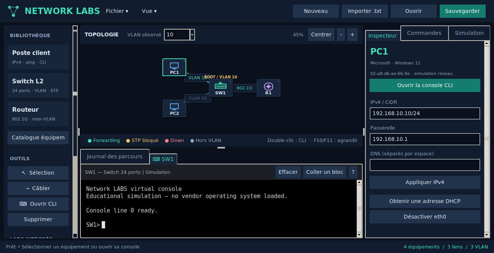
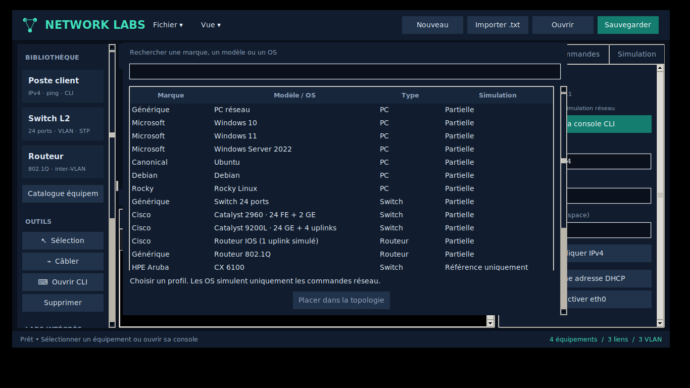

# Network LABS · Switching Studio

Application native Linux pour construire des labs réseau **sans VM, sans images
IOS et sans trafic sur le réseau réel**. CLI inspirée IOS sur chaque switch et
routeur, CLI réseau simplifiée sur les PC. Interface et aide en français.


## Démarrer sous Ubuntu

```bash
sudo apt install python3 python3-tk
git clone -b prototype/linux-simulator https://github.com/sou1915/Network-LABS.git
cd Network-LABS
python3 -m network_labs
```

Pour mettre une copie existante à jour :

```bash
git switch prototype/linux-simulator
git pull --ff-only
python3 -m network_labs
```

Python 3.10+ et Tkinter suffisent : aucune dépendance pip pour l'application.

## Espace de travail

La fenêtre se dimensionne selon l'écran (notamment 1366×768). Les panneaux latéraux
sont défilants et se masquent automatiquement aux petites largeurs. Le menu **Vue**
permet de les réafficher. **F10** agrandit/restaure la topologie, **F11** la console.
Le prompt est remis en vue après commandes, redimensionnements et changements d'onglet,
sans modifier la séparation des panneaux à chaque configuration. Les dialogues de port
et de configuration s'adaptent aussi à la taille d'écran.

- Cliquer sur un équipement de la bibliothèque puis dans la topologie pour le placer.
- Glisser les équipements ; molette pour zoomer ; clic milieu pour déplacer la vue.
- Choisir **Câbler**, cliquer sur deux équipements, choisir les ports physiques et le mode initial.
- **Double-cliquer sur un équipement pour choisir GUI ou CLI** dans sa fenêtre de configuration. La console du dock reste disponible.
  Console noire, texte monochrome, curseur bloc et saisie directement après le prompt ;
  aucune zone de saisie séparée. Le transcript est protégé contre les modifications.
  `Ctrl+C` interrompt la saisie (ou copie la sélection), `Ctrl+Z` quitte le mode configuration,
  `Ctrl+A/E` déplace le curseur au début/à la fin de la commande.
- Cliquer sur un switch : liste de ses ports. Double-cliquer sur un port pour le configurer.
- Cliquer sur un câble pour inspecter et configurer chaque extrémité indépendamment ou le couper.
- Choisir le VLAN observé : root STP, liens bloqués, liens down et liens hors VLAN sont distingués.
- Dans l’onglet **Simulation** à droite, lancer le ping depuis un PC, puis utiliser Lecture, Pause, Étape, Rejouer et le curseur de vitesse.
- Le journal donne le VLAN et les ports de chaque saut. Les consoles ont aide `?`, historique,
  suggestions avec Tab et éditeur de blocs multi-lignes, avec arrêt à la première erreur.
- Sauvegarder le projet en JSON (`Ctrl+S`). Les projets de l'ancien prototype sont migrés à l'ouverture.

Six labs intégrés : **Inter-VLAN**, **Boucle STP**, **EtherChannel**, **DHCP / Sécurité**, **VTP v2**, **MST instances**.

## Ce que le moteur prend en charge

| Fonction | Configuration et effet |
|---|---|
| VLAN | Création, noms, suppression ; isolation par VLAN |
| Ports | Ports indépendants, interfaces/ranges, description, shutdown/no shutdown |
| 802.1Q | Access/trunk, listes allowed avec add/remove/all/none, VLAN natif |
| DTP | Modes dynamic auto/desirable, trunk statique et nonegotiate ; mode opérationnel calculé |
| DHCP | Pools sur routeur, exclusions, passerelle, DNS, durée de bail ; client PC, renouvellement/libération |
| DHCP snooping | Réponses serveur rejetées sur ports non trusted ; bindings IP/MAC/VLAN/port |
| DAI / IP Source Guard | Vérification d’identité à l’entrée des ports ; rejet si binding absent, erroné ou expiré |
| VTP v2 | Modes server/client/transparent/off, domaine, mot de passe, révision et propagation des VLANs standard sur trunks |
| MST | Région, révision, mapping VLAN/instance, élection et priorités par instance ; modèle mono-région |
| STP | Calcul convergé par VLAN, élection root, coûts, priorités de bridge/port, ports ROOT/DESG/ALTN |
| EtherChannel | Plusieurs câbles entre switches ; LACP active/passive, PAgP desirable/auto et mode on ; validation des membres ; redondance |
| Protection L2 | Port-security maximum, MAC, sticky, violation shutdown/restrict/protect ; BPDU Guard |
| MAC | Apprentissage simplifié sur les chemins traversés, consultation/effacement de table |
| Routeur | Sous-interfaces dot1Q, adresses IPv4, shutdown, routes connectées |
| PC | IPv4/passerelle par GUI ou CLI, ipconfig, ping PC et passerelle locale |
| Inspection | Running/startup config, VLAN, interfaces, trunks, STP, EtherChannel, port-security, voisins physiques |

La CLI reste un sous-ensemble, pas une copie complète d’IOS : abréviations courantes,
aide contextuelle, Tab et filtres `show ... | include/exclude/begin` sont pris en charge.
Pas de pagination IOS, de grammaire exhaustive ni de profils exacts multi-vendeur.

Exemples complets et commandes : [docs/SWITCHING.md](docs/SWITCHING.md).

## Limites explicites

Ce projet ne reproduit **pas toutes les technologies de switching**, ni un IOS constructeur.
Une commande inconnue ou une fonctionnalité non implémentée est refusée ; elle n'est pas
acceptée pour donner l'impression de fonctionner.

Le moteur vérifie des chemins et fait un apprentissage MAC pédagogique. Il ne simule pas
encore les échanges réels ARP, BPDUs, LACP/PAgP PDUs, le flooding inconnu, les délais,
la convergence temporelle, les files de transmission ou les pertes. Les marqueurs animés
représentent les chemins calculés, pas une capture réseau. Les tables MAC ne pilotent pas
encore une commutation de trames événementielle.

`pvst` et `rapid-pvst` partagent le calcul de l'état convergé ; leur différence de temporisation
n'est pas simulée. PortFast se configure, mais n'accélère rien dans ce modèle sans timers.
BPDU Guard détecte un switch voisin depuis la topologie, pas à partir d'un BPDU émis.
L'agrégation vérifie la compatibilité et fournit la redondance, sans hash de flux ni simulation
de bande passante. Les voisins `show cdp/lldp neighbors` sont déduits des câbles.

Le simulateur bloque conservativement un trunk dont les deux VLAN natifs diffèrent ;
il ne reproduit pas la traduction potentielle du trafic non tagué par des équipements réels.
Pas de VLAN voix, VTP v1/v3, interconnexion MST multi-région/PVST, QoS, IGMP snooping, 802.1X,
ACL/NAT, OSPF/BGP ou profils constructeur exacts pour l'instant.

DTP calcule le résultat de négociation et compare les noms de domaine, sans trames ni timers.
VTP v2 transmet instantanément les VLANs 1..1005 entre domaines/mots de passe compatibles ;
les VLANs étendus restent locaux. Pas de messages, digest, retransmission ou gestion complète
des révisions constructeurs. Les trunks restent configurables manuellement entre domaines différents.
MST utilise un arbre convergé commun aux VLANs de chaque instance dans une seule région
cohérente. Les liens inter-switch MST doivent être trunk. Les frontières de régions et
MST/PVST sont bloquées conservativement et signalées comme non modélisées, pas comme
le comportement d’un vrai équipement. Les timers/BPDUs MST et l’interconnexion CIST
ne sont pas implémentés.
DHCP modélise les étapes Discover/Offer/Request/ACK et l’allocation, sans transport
de paquets, relais, Option 82 ou retransmissions. La recherche d’adresse est limitée
aux 65536 premiers hôtes du pool. Les baux et bindings sont des états d’exécution non
sauvegardés : refaire `ip dhcp` après réouverture d’un projet. La durée de bail est
vérifiée à la consultation/utilisation des bindings, sans timer de renouvellement automatique.
DAI vérifie l’identité du sender lors d’un test de connectivité, comme condition
préalable ARP ; pas encore d’analyse de vrais paquets ARP. Pas d’ARP ACL statique.
IP Source Guard s’appuie sur les mêmes bindings et est limité aux ports access.
Le routeur a un seul uplink physique, avec routage connecté et sous-interfaces 802.1Q.
Le ping est émis par un PC ; les interfaces de routeur ciblées doivent être dans son réseau local.

## Tests

```bash
python3 -m unittest discover -s tests -v
```

Les tests GUI sont exécutés si un écran X est disponible. Pour les inclure sans écran physique :

```bash
sudo apt install xvfb
xvfb-run -a python3 -m unittest discover -s tests -v
```

Ils couvrent la configuration via console, l'effet sur le ping, le contrôle d'animation,
les onglets CLI, les dialogues de configuration, la sauvegarde et les labs intégrés.
Les tests de régression vérifient le prompt après commandes répétées à 1300×668,
1024×600 et 900×500, ainsi que les modes de focus F10/F11.

[Aperçu sur écran 1366×768](docs/laptop.png).

### Import texte et catalogue

Le menu **Fichier → Importer un lab texte** permet de préparer un lab dans un
éditeur externe, valider chaque ligne, puis appliquer la topologie et ses
configurations ensemble. Une erreur conserve le lab actuel. Voir
`examples/inter_vlan.lab.txt`. L'import CLI s'applique aussi à un équipement
sélectionné ; l'export texte permet de reprendre le lab plus tard.

Le bouton **Catalogue · OS / marques** propose Windows 10/11/Server 2022,
Ubuntu, Debian, Rocky Linux, des profils génériques et Cisco IOS pédagogiques.
Les PC simulent uniquement le réseau : prompts, IPv4, passerelle, DHCP, ping,
`ip addr`/`ip route` sous Linux, `ipconfig`/`route print` et configuration IPv4
`netsh` sous Windows. Aucun système d'exploitation ni application n'est exécuté.
Dans `[devices]`, utiliser par exemple `PC1 windows-11` ou `PC2 linux-ubuntu`.
Le profil est conservé dans les sauvegardes JSON et les exports texte.

Aruba, Juniper, Arista, Huawei, MikroTik, Fortinet et Palo Alto sont actuellement
des références consultables, sans création : leurs CLI et moteurs spécifiques
ne sont pas implémentés. Le catalogue n'est pas exhaustif. Les profils Catalyst 2960 (24 FE + 2 GE) et 9200L (24 GE + 4 uplinks)
utilisent des noms de ports spécifiques mais le moteur pédagogique partagé ;
il ne reproduit pas toutes les variantes matérielles et fonctions constructeur.

802.1X utilise un backend RADIUS local simulé (`[radius]` dans le fichier texte),
sans EAPOL ni trafic RADIUS. IGMP snooping modélise les abonnements et la sélection
des ports, sans querier, temporisations ou routage multicast.

Les interfaces PC peuvent être activées/désactivées depuis l’inspecteur et sous
Linux avec `sudo ip link set dev eth0 up|down`. Les commandes `resolvectl dns`
et `netsh interface ipv4 set dnsservers` règlent la liste DNS ; la résolution
locale A est disponible via un profil Serveur DNS, sans cache ni récursion Internet. L’aide `?`/`help` expose les commandes du profil OS.
Les paramètres netsh non simulés sont rejetés avant toute modification.

Exemple prêt à importer : [`examples/windows_linux.lab.txt`](examples/windows_linux.lab.txt)
(Windows 11 et Ubuntu, commandes natives, VLAN 10/20 et routeur inter-VLAN).




### LAN entreprise et périphériques

Le lab **07 LAN entreprise** ajoute serveur DNS, imprimante, NAS, caméra IP,
téléphone IP et capteur Ethernet. Dans le catalogue, filtrer par rôle ;
`show device` décrit les fonctions et limites du profil. Les endpoints spécialisés
ont une console de simulation LAN et une seule interface Ethernet ; impression,
fichiers, voix et vidéo ne sont pas exécutés.

DNS local A : configurer `service dns` et `dns record printer.lan 192.168.10.20`
sur un profil Serveur, puis `ip dns 192.168.10.2` et `ping printer.lan` ou
`nslookup printer.lan` sur les clients. L'inspecteur Serveur propose un éditeur
DNS. Le DHCP du lab distribue automatiquement l'adresse du serveur DNS.

[Couverture LAN, limites et commandes](docs/LAN.md) ·
[Exemple complet à importer](examples/enterprise_lan.lab.txt).

### Firewalls LAN

Le lab **08 Firewall LAN** ajoute un firewall transparent à deux ports,
avec règles IPv4 source/destination sur les tests ICMP, mode stateful/stateless,
politique par défaut et éditeur GUI. Des profils génériques et identités Fortinet,
Palo Alto, Cisco ASA, pfSense, OPNsense, Sophos, Check Point, SonicWall et Juniper
partagent ce modèle pédagogique ; leurs systèmes et CLI natifs ne sont pas chargés.
NGFW/UTM/WAF/proxy/firewall hôte/routé restent des références non créables.

[Types, commandes et limites précises](docs/FIREWALLS.md) ·
[Exemple firewall LAN](examples/firewall_lan.lab.txt).

### Choix GUI / CLI par équipement

Double-cliquer sur un node, ou **Inspecteur → Configurer en GUI / CLI**. La même
fenêtre contient les formulaires GUI, la console et une vue de la configuration.
Les formulaires appliquent les mêmes commandes que la CLI, de façon atomique ;
une erreur conserve toute la configuration précédente. Si la CLI modifie un
équipement pendant l’édition d’un formulaire, actualiser avant d’appliquer.

GUI disponible pour les profils créables : réseau IPv4/DHCP des endpoints,
VLANs/interfaces/STP/MST/VTP/EtherChannel/protections des switches,
sous-interfaces 802.1Q et serveur DHCP des routeurs, DNS et politiques firewall
intégrés pour les rôles correspondants. Les limites des moteurs restent celles
des profils : il ne s’agit pas d’une copie du GUI constructeur.

[Guide GUI/CLI et couverture des formulaires](docs/GUI.md).
