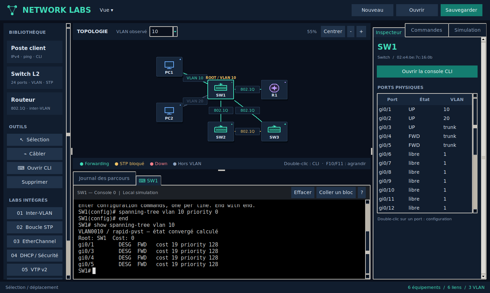
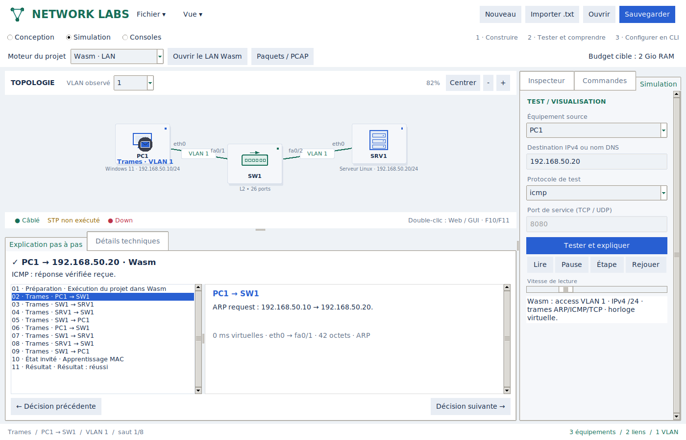
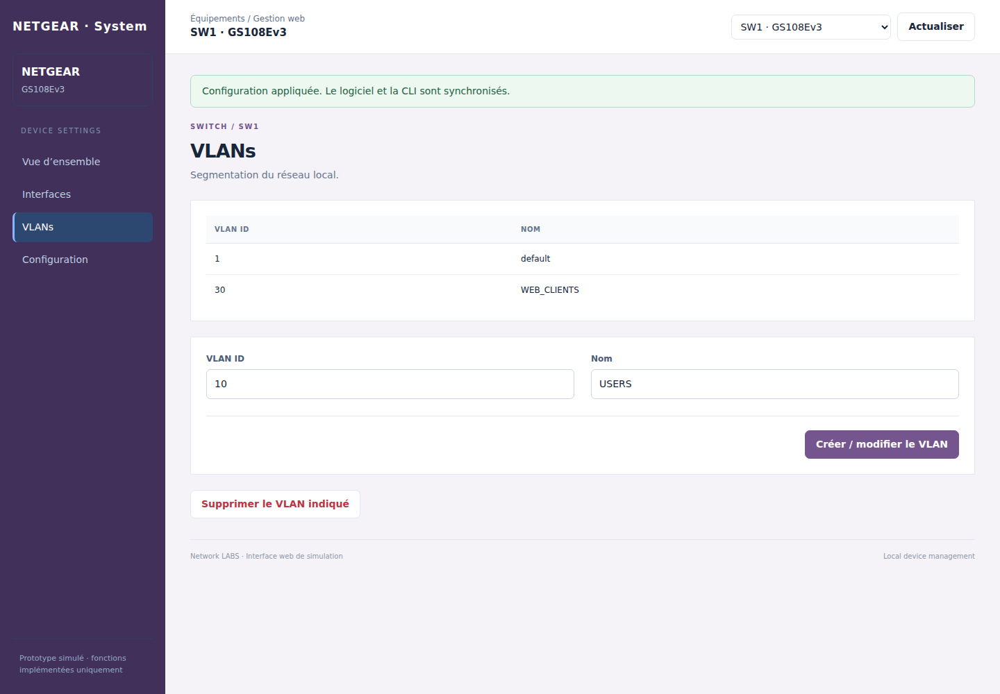

# Network LABS

Simulateur réseau pédagogique pour Linux : construire une topologie LAN,
configurer les équipements depuis une page web, des formulaires bureau ou une
CLI, puis tester les trajets et les politiques. Sans VM, image constructeur,
privilège root ou trafic vers les IP virtuelles.



## Installation et lancement

Python **3.12 ou plus récent**, Tkinter et un environnement graphique Linux.
Sous Ubuntu/Debian/Mint :

```bash
sudo apt update
sudo apt install -y git python3 python3-tk
git clone --branch prototype/linux-simulator https://github.com/sou1915/Network-LABS.git
cd Network-LABS
python3 -m network_labs
```

Pour une copie déjà installée :

```bash
git switch prototype/linux-simulator
git pull --ff-only
python3 -m network_labs
```

Aucune dépendance pip/npm pour l'utilisation normale. Le navigateur local du
système ouvre les pages de gestion ; le logiciel doit rester actif.

## Micro-nodes Linux natifs et microVMs (expérimental)

**Fichier → Micro-nodes natifs · runtimes / manifest**, ou
`python3 -m network_labs --native-lab`, ouvre le diagnostic des runtimes et un
éditeur de lab JSON avec validation et budget mémoire cible. Le laboratoire
natif est distinct du canvas pédagogique : il ne convertit pas automatiquement
les modèles constructeur ni leurs configurations.

Le nouveau gestionnaire peut démarrer des **containers OCI/crun persistants**,
relier leurs namespaces par veth et lancer des **microVMs Firecracker** optionnelles
sur le même fabric via TAP. Rootfs, kernel et disque sont fournis explicitement.
Les commandes OCI sont exécutées dans le node réel. Le démarrage/arrêt nécessite
sudo dans un terminal ; conserver la GUI sans privilèges. Libkrun, Unikraft,
Hyperlight/Nanvix, WASI 0.3 et netkit sont identifiés comme pistes non intégrées.

```bash
python3 -m network_labs.appliances doctor
```

[Guide d'installation, premier ping réel, limites et validation](docs/HYBRID_APPLIANCES.md).

### Premier moteur LAN autonome

Le scénario natif `example --campus` crée **8 nodes** avec VLAN access/trunk,
sous-interfaces 802.1Q, routage inter-VLAN et DHCP BusyBox réel. Une CLI partielle
`ios-basic` applique les blocs supportés sur les namespaces Linux ; `inspect`
lit les interfaces/routes/VLAN du kernel. `save` conserve un manifest startup
durable et `restore` recrée le lab après arrêt. Ce moteur ne dépend pas de Tk.

```bash
python3 -m network_labs.appliances example --campus --rootfs "$HOME/network-labs-rootfs" > campus-lan.json
python3 -m network_labs.appliances plan campus-lan.json
```

[Lancement, commandes couvertes, sauvegarde et critères de validation](docs/NATIVE_LAN_CORE.md).
Le backend Linux propose aussi un firewall IPv4 stateful et masquerade/SNAT/DNAT
(`example --firewall`), avec règles, compteurs, sessions et sauvegarde.
Le scénario `example --enterprise` intègre 20 nodes (12 PC, 4 switches,
routeur, firewall, DHCP et WAN). `benchmark` mesure le repos et une charge ICMP
parallèle puis nettoie le lab. Le scénario `example --lacp` ajoute un trunk VLAN sur deux liens agrégés par LACP Linux,
avec inspection de négociation et seuil min-links. `example --stp` ajoute une boucle contrôlée par le STP commun 802.1D du kernel, avec protections BPDU Guard/Root Guard optionnelles.
`explain LAB [NODE]` ajoute un diagnostic passif lisible en français, ou structuré avec `--json`, fondé sur les états réels du kernel.
`capture LAB NODE INTERFACE --output trace.pcap` enregistre les vraies trames du node avec durée/paquets/taille bornés et filtres BPF (tcpdump/nsenter/timeout optionnels).
Le budget total 2 Gio et RSTP restent à valider/implémenter.

## Essai facultatif : micro-appliances Wasm

Le choix **Moteur du projet → Wasm · LAN** exécute les endpoints et switches de
la topologie courante dans des instances Wasm indépendantes : pile smoltcp,
apprentissage MAC, octets ARP/ICMP et handshake/données TCP echo. Les adresses,
câbles et shutdown configurés en GUI/CLI sont utilisés. **Paquets / PCAP** ouvre
la capture du test. Le moteur pédagogique reste disponible pour les fonctions
non portées ; aucun repli automatique ne masque une limitation du backend Wasm.

Après installation du runtime facultatif, ouvrir directement le projet LAN éditable :

```bash
.venv-micro/bin/python -m network_labs --wasm-lan
```

Périmètre actuel : LAN access VLAN 1 sans boucle active, IPv4 statique /24,
ICMP et TCP echo/8080. Les instances sont recréées à chaque test ; aucun noyau OS
invité ni firmware constructeur. Budget cible du programme : **2 Gio RAM**,
sans garantie de consommation maximale. [Intégration au projet](docs/WASM_PROJECT.md)
et [installation, sources et mesures](docs/MICRO_APPLIANCES.md).



## Un espace pour chaque tâche

Pour comprendre le rôle de Python, Rust, Wasm et des commandes natives :
[architecture et limites expliquées](docs/ARCHITECTURE_FR.md).

Première page de marque spécialisée : **FortiGate → Firewall Policy / Addresses**,
avec formulaires natifs partiels, aperçu CLI, objets nommés et ordre `move before/after`
effectif. Lancer `.venv-micro/bin/python -m network_labs --fortigate-lab` ou
**Fichier → Lab FortiGate · Firewall Policy**. Les autres familles ne sont pas
encore des répliques fidèles de chaque firmware. [Détails](docs/FIREWALLS.md).

**Conception** affiche le plan et les catégories Nodes/Outils/Labs.
**Simulation** réunit les tests ICMP/TCP/UDP, l'animation et une explication
sélectionnable de chaque décision : demande, DNS, sauts aller/retour, filtrage
et résultat. **Consoles** donne tout l'espace aux terminaux.

Les présentations web dépendent maintenant de la famille : bureau NAS, écran
caméra, état imprimante/téléphone, paramètres Windows/Linux, dashboards et
navigations FortiGate/Palo Alto/pfSense, ainsi que présentations de switches.
Ce sont des interfaces **inspirées**, pas des copies complètes des firmwares.

Les consoles interactives séparent la grammaire interne du simulateur des
sous-ensembles IOS, Windows, Linux, FortiOS, PAN-OS et RouterOS. Une CLI non
implémentée est annoncée comme telle. Voir la [matrice de fidélité, exemples et
limites](docs/FIDELITY.md) et le [guide de simulation](docs/SIMULATION.md).

## Choisir web, GUI bureau ou CLI

- Double-clic sur un équipement réseau : **page web locale réelle**.
- Double-clic sur un poste/portable : configuration bureau.
- Inspecteur : **Interface web · navigateur**, **Configuration bureau / CLI**,
  ou console CLI dans le dock.
- Clic droit : mêmes choix ; double-clic sur un port : formulaire Interfaces.
- Les formulaires, pages web et consoles partagent la même configuration.
  Validation atomique des groupes de commandes et détection des formulaires obsolètes.
- La page web propose inventaire, interfaces, VLANs, DNS, services, firewall,
  diagnostics et configuration. Les options avancées restent dans l’éditeur technique ; la CLI dépend du dialecte implémenté.
- Thème bureau clair, panneaux défilants et tailles adaptées à l'écran. F10
  agrandit la topologie, F11 la console du dock. Le prompt reste visible.

[Guide web](docs/WEB.md) · [Formulaires bureau](docs/GUI.md).



## Construire et sauvegarder un lab

Choisir un équipement dans la bibliothèque ou le catalogue, puis cliquer dans
la topologie. Déplacer les nodes, choisir « Câbler » puis les deux extrémités et
ports. Le catalogue filtre rôle, marque et modèle. Chaque profil annonce ses
fonctions réelles dans le simulateur ; les références non implémentées ne sont
pas créables.

Les ports sont indépendants : occupation, état administratif, VLANs/trunks,
protections et configuration. Sauvegarder/ouvrir le projet au format JSON.
**Fichier → Importer un lab texte** construit équipements, câbles et
configurations après validation/aperçu. Une erreur indique la ligne et conserve
le lab actuel. Import CLI par équipement et export texte sont également disponibles.

Exemples : [inter-VLAN](examples/inter_vlan.lab.txt),
[Windows/Linux](examples/windows_linux.lab.txt),
[LAN entreprise](examples/enterprise_lan.lab.txt),
[firewall](examples/firewall_lan.lab.txt),
[services TCP/UDP](examples/service_firewall.lab.txt).

## Moteurs et labs

| Domaine | Fonctions simulées |
| --- | --- |
| Switching | VLAN/access/trunk/native/allowed, ports et ranges, DTP, STP convergé, EtherChannel LACP/PAgP/statique |
| Distribution VLAN | VTP v2 server/client/transparent/off ; MST mono-région et mapping par instance |
| Protections LAN | Port-security/sticky/violation, BPDU Guard, PortFast, DHCP snooping, DAI/IP Source Guard |
| Accès / multicast | Autorisation 802.1X avec backend RADIUS local ; IGMP snooping basé sur les abonnements |
| IPv4 | Adresses/passerelles, router-on-a-stick 802.1Q et réseaux connectés, DHCP serveur/client et exclusions |
| DNS | Serveur local A, édition GUI/web, nslookup et ping par nom ; contrôle d'accès UDP/53 |
| Services | Disponibilité de ports TCP/UDP, sondes et chemins aller-retour ; listes persistantes par endpoint |
| Firewall | Transparent deux ports, règles IPv4/protocole/port, ordre par ID ou séquence native, stateful/stateless et compteurs |

Neuf labs intégrés : inter-VLAN, boucle STP, EtherChannel, DHCP/sécurité, VTP,
MST, LAN entreprise, firewall LAN et services TCP/UDP.

Dans le lab 09 :

```text
probe tcp nas.lan 445
probe tcp printer.lan 9100
probe tcp camera.lan 554
```

NAS/imprimante sont autorisés ; caméra refusée par la règle 40. Ping peut échouer
alors qu'un service TCP passe : les politiques sont distinctes. Le journal de
simulation indique protocole/port, sauts et diagnostics.

[Switching](docs/SWITCHING.md) · [LAN](docs/LAN.md) ·
[Services](docs/SERVICES.md) · [Firewalls](docs/FIREWALLS.md).

## Matériel et profils

Postes Windows 10/11/Server et Linux Ubuntu/Debian/Rocky, serveurs, imprimantes,
NAS, caméras, téléphones IP, IoT et portables Ethernet. Profils HP, Synology,
Axis, Yealink, QNAP, Brother, Dell/HPE/Lenovo ; modèles de ports Cisco 2960/9200L,
TP-Link TL-SG108E, NETGEAR GS108Ev3, Aruba Instant On 1930, UniFi Lite 8 PoE,
MikroTik CRS326 et D-Link DGS-1210-28. Identités firewall Fortinet, Palo Alto,
Cisco ASA, pfSense, OPNsense, Sophos, Check Point, SonicWall et Juniper.

Les marques/modèles ne chargent pas leur firmware ou leur GUI natif : moteur
pédagogique partagé, gestionnaire web du simulateur et capacité de ports indiquée.
Le catalogue n'est pas exhaustif. [Détails et sources des profils](docs/MODELS.md).

## Limites importantes du modèle

Dans le moteur pédagogique principal : pas de vrais paquets, stack TCP/UDP, handshakes, retransmissions, délai/débit
mesuré ou OS constructeur. Les services sont des tests de disponibilité, sans
exécution SMB/HTTP, fichiers, impression, vidéo ou voix. Le port firewall est le
port de service pour les deux jambes ; état limité à la transaction courante,
sans ports clients éphémères. DHCP/multicast et protocoles L2 ne sont pas filtrés
par ces règles de transactions.

DNS sans récursion/cache/TTL ; protocoles L2 convergés sans timers ; MST limité
à une région cohérente, frontières mixtes bloquées et signalées. Pas encore de
Wi-Fi, PoE, voice VLAN/passthrough téléphone, SVI/L3, ACL/NAT, VPN, routage dynamique,
IPS/antivirus, NGFW/WAF/proxy ou reproduction exhaustive des CLI et matériels.
Les commandes non implémentées sont rejetées.

## Tests

Validation locale : **162 tests réussis**, dont **24 tests GUI** sous Tk/Xvfb,
avec Wasmtime installé, plus le contrôle des pages dans Chrome Headless.
Les tests du prototype sont ignorés lorsque son runtime n'est pas installé.
Le contrôle navigateur facultatif vérifie 23 présentations et leur affichage mobile,
ainsi que des modifications réelles du modèle via HTTP.

```bash
python3 -m unittest discover -s tests -v
```

Les tests GUI nécessitent un écran X :

```bash
sudo apt install -y xvfb
xvfb-run -a python3 -m unittest discover -s tests -v
```

Tests API/HTTP locaux, atomicité, persistance, ports, protocoles, politiques et
synchronisation GUI/CLI inclus. Vérification navigateur facultative avec
Playwright : voir [WEB.md](docs/WEB.md). La CLI utilisateur n'exige pas Node.
