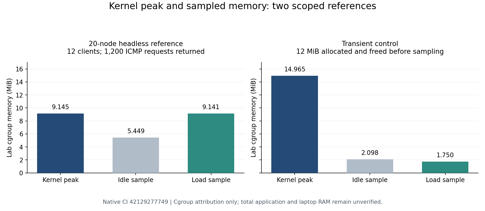

# Headless cgroup kernel peak and the 20-node reference

Benchmark report version 2 adds the cgroup-v2 `memory.peak` high-water mark.
The existing idle/load sampling remains useful, but can miss startup charges
or short-lived allocations between samples. The new kernel value reports the
highest memory charged to the lab's parent cgroup and descendants through
the final post-load snapshot, before teardown. It does not measure all host
startup work, all kernel/network memory, the desktop or total application RAM.

The existing CLI now includes these fields without a new benchmark flag:

```bash
sudo python3 -m network_labs.appliances benchmark enterprise-20.json \
  --seconds 10 --target 198.51.100.10 --output benchmark-20-v2.json
```

- `lab_cgroup_after_load.memory_peak_bytes`: kernel lifetime high-water mark.
- `lab_cgroup_context`: whether the parent existed before startup, its old
  peak if available, and explicit lifetime provenance.
- `assessment.lab_cgroup_lifetime_peak_under_target`: lifetime peak versus
  the manifest budget, or null when unsupported.
- `assessment.lab_cgroup_current_run_kernel_peak_under_target`: a current-run
  verdict only for a fresh parent with kernel support; otherwise null.

Missing `memory.peak` support is unknown, never zero or a passing kernel
measurement. Invalid/inaccessible counters fail rather than fabricate values.
A populated pre-existing parent refuses benchmarking before allocation;
an empty parent may retain earlier runs' peak/cached charges and is labeled
accordingly. No counters are reset. Use a fresh lab name for isolated lifetime
attribution. Per-node values must not be added to the parent again. OOM events
include parent/descendant history, so prior-context provenance also matters.
Version-1 reports remain historical sampled measurements; summary rendering
does not invent missing kernel fields for them.

The runner's PSS and host available-memory deltas retain their existing
separate scope. Shared pages and unrelated host activity prevent a simple
sum from establishing total app RAM. `total_application_under_target` remains
`unverified`. Empty cgroup ancestors may remain after owned runtime cleanup;
they must have no populated descendant tasks.

## Dedicated native validation

The transient control creates a fresh three-node lab, retains 6 MiB in each
of two owned-node tmpfs mounts, then frees both allocations before sampling.
Its kernel peak must catch at least 12 MiB and exceed both phase samples by
more than 4 MiB. This demonstrates a real missed pre-sampling allocation;
it is not a workload/throughput result.

The 20-node test uses the existing enterprise return-route reference with
an explicit DHCP-host /32 return route, a fresh lab/cgroup name, 10 seconds
idle and 10 seconds ICMP load. Twelve clients each send 100 packets at 10/s.
All 1,200 requests must receive replies, all nodes must remain running, no
OOM kill may be observed, and the fresh kernel peak must remain below the
declared 2 GiB lab budget. Host namespace/link/route/rule/forwarding/nftables
invariants and stopped-runtime cleanup are checked. A separate step repeats
the older enterprise benchmark plus actual HTTP/NAT/return-route/save-restore
regression. JSON measurement reports are retained as a workflow artifact.

These short headless shared-kernel references do not validate GUI/heavy
services, vendor firmware, VMs, every topology, maximum throughput or the
whole application/laptop 2 GiB target. Those acceptance checks remain open.

At implementation commit `1ad4241d651fa3ebf6e70d3b10017aa028100712`,
the [dedicated native job](https://github.com/sou1915/Network-LABS/actions/runs/42129277749/job/127601472273)
passed both new scenarios in 29.601 seconds and the existing enterprise
regression in 21.131 seconds. General CI also passed: both selected jobs
succeeded; 57 other jobs were intentionally skipped. Local tests passed
985 cases in 30.977 seconds with 159 environment-dependent skips; compilation,
diff and documentation-link checks passed. No failed native run preceded this
checkpoint.

On kernel `7.0.0-1017-azure`, x86_64, four logical CPUs:

| Reference | Kernel cgroup peak | Idle sampled peak | Load sampled peak |
| --- | ---: | ---: | ---: |
| 20 nodes, 10s idle + 10s ICMP | 9.145 MiB | 5.449 MiB | 9.141 MiB |
| Presampling transient control | 14.965 MiB | 2.098 MiB | 1.750 MiB |

The following illustration is generated from those retained JSON reports;
it compares measurement methods within each reference, not performance of
equivalent workloads:



Both parents were fresh, all requested packets returned and no OOM kill was
observed. The 20-node kernel peak was 9,588,736 bytes; its startup/readiness
took about 4.43 seconds. These are one runner/reference measurements with the
scope above, not total app RAM or a comparison of equivalent workloads.

Exact artifact JSON is retained in the repository:
[20-node report](benchmarks/enterprise-20-kernel-peak-ci.json),
[transient report](benchmarks/presampling-transient-kernel-peak-ci.json), and
[source/digest provenance](benchmarks/kernel-peak-ci-provenance.json).
The downloaded ZIP matched GitHub's SHA-256
`4900d5fe17670d61eed9f0a3a9d34a50f038488057e4c971e687e3fe0456b8a7`;
the provenance file records each unchanged JSON member's digest too.
The older [version-1 report](benchmarks/enterprise-20-ci.json) remains separate
historical sampled evidence.

Run with:
`gh workflow run tests.yml --ref handoff/codex-dot1x-2026-11-04 -f suite=benchmark-kernel-peak`.
General CI is also selected; other jobs are intentionally skipped, not newly
validated by this selection.
