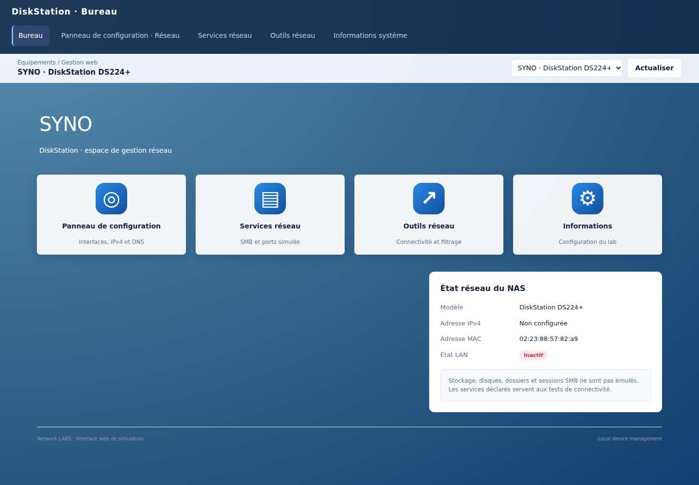
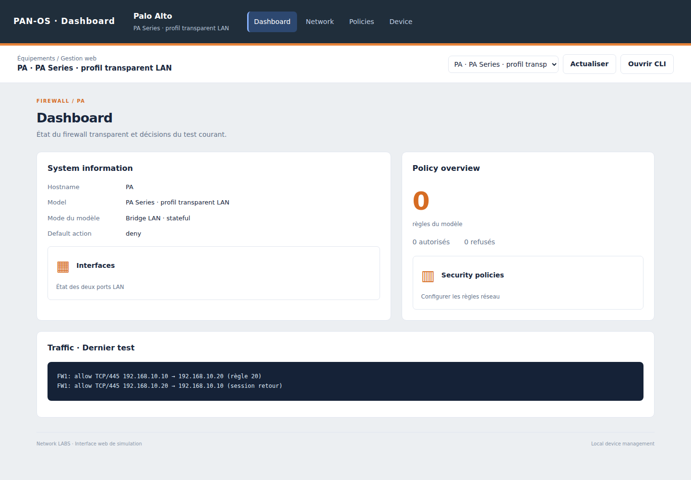
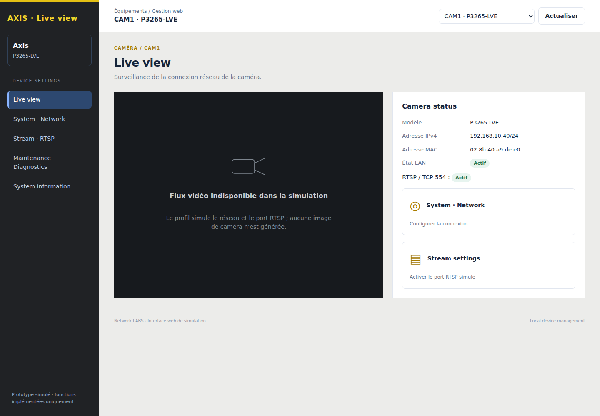
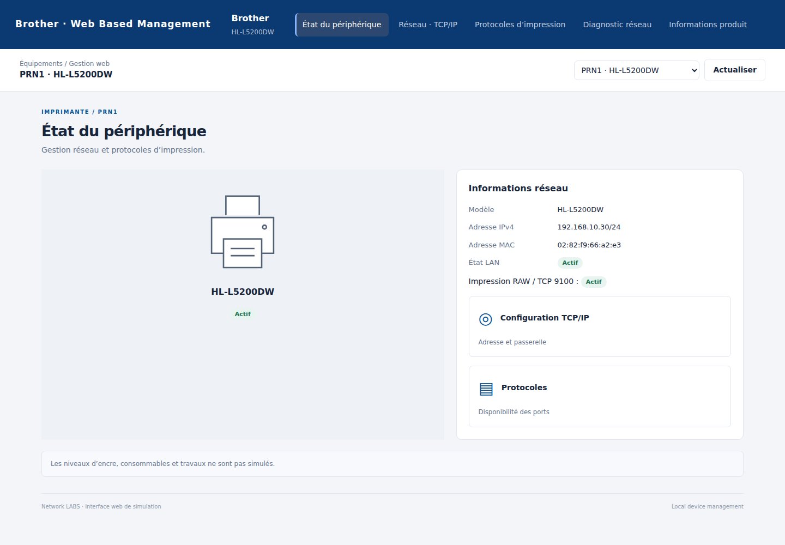
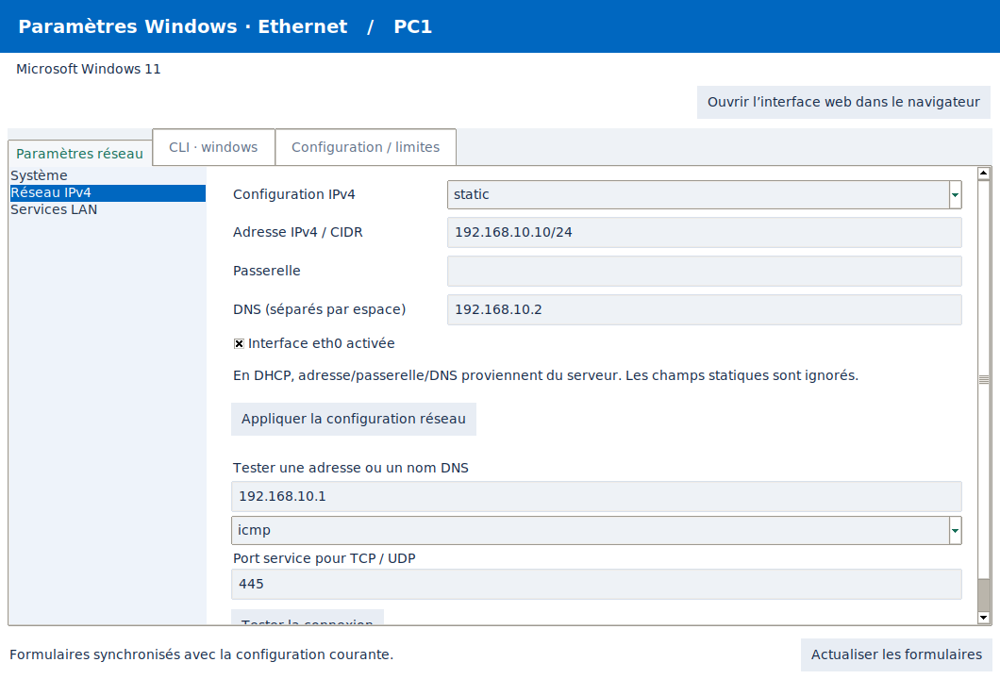

# Interfaces et commandes : couverture exacte

L'objectif est d'apprendre les gestes et syntaxes des systèmes représentés.
Cette version distingue la présentation par famille, les commandes constructeur
implémentées et la grammaire interne utilisée par les formulaires/imports.
**Une interface inspirée n'est pas une réplique complète d'une version de firmware.**

## Organisation du bureau

- **Conception** : topologie et bibliothèque, avec catégories Nodes / Outils / Labs.
- **Simulation** : topologie, paramètres du test et explication pas à pas.
- **Consoles** : espace dédié aux terminaux, sans bibliothèque/inspecteur latéraux.
- Les réglages d'un node utilisent une liste de sections, sans second niveau
  d'onglets. Windows et Linux ont une présentation de paramètres distincte.
- L'onglet Commandes de l'inspecteur suit l'équipement sélectionné.

## Présentations web

| Famille | Structure implémentée |
| --- | --- |
| Windows / Linux | Paramètres Ethernet et propriétés du poste |
| Synology / QNAP | Bureau NAS, raccourcis vers réseau/services, état LAN ; dispositions DSM/QTS distinctes |
| HP / Brother | État de l'imprimante, informations produit et protocoles réseau |
| Axis | Zone de visualisation vide explicitement annoncée, état réseau et RTSP |
| Yealink | État réseau, écran du téléphone et disponibilité du port SIP |
| FortiGate | Navigation latérale Dashboard / Network / Policy & Objects |
| Palo Alto | Navigation horizontale Dashboard / Policies / Network / Device |
| pfSense / OPNsense | Navigation Status/Interfaces/Firewall ou Lobby/Interfaces/Firewall |
| ASA, Sophos, Check Point, SonicWall, Juniper SRX | Présentations et catégories distinctes inspirées de leur famille ; CLI non implémentées |
| Cisco, TP-Link, NETGEAR, Aruba, D-Link | Présentations Device Manager / Easy Smart / System / Local Management |
| UniFi | Présentation sombre Devices / Port Manager / Networks |
| MikroTik | Présentation WebFig, interfaces et VLANs du moteur partagé |

Les formulaires avancés du bureau restent des outils du simulateur. Les pages
web des smart switches masquent VTP et les réglages IOS globaux. Les firewalls
ne proposent plus de switchport/DTP/PortFast dans leur page d'interfaces.
Aucun taux d'encre, volume disque, flux vidéo, charge CPU, débit ou enregistrement
SIP fictif n'est présenté comme une mesure réelle.

## Consoles interactives

| Profil | Syntaxe exposée | Limites principales |
| --- | --- | --- |
| Cisco et routeurs/switches génériques IOS | Modes EXEC/config, VLAN, interfaces et commandes du moteur existant | Sous-ensemble IOS, sans firmware ni support exhaustif |
| Windows | `ipconfig`, `netsh interface ipv4`, `route print`, `ping`, `nslookup` | Réseau uniquement, pas de CMD/PowerShell général |
| Linux | `ip addr/link/route`, `dhclient`, `resolvectl`, `ping`, `nslookup` | Interface abstraite eth0, IPv4 uniquement, pas de shell général |
| FortiGate | `config system global`, interfaces `port1/port2`, objets IPv4 et politiques | Transparent, interfaces `any`, schedule `always`, un service prédéfini par règle ; pas de NAT/VDOM/custom service |
| Palo Alto | `configure`, `set deviceconfig system hostname`, règles, `show`, `commit`, `revert config` | Candidate locale à la console, from/to/application `any`, services any/HTTP/HTTPS ; pas de zones/App-ID/NAT |
| MikroTik CRS326 | `/system identity`, `/interface print`, `/interface set` | Identité, état et commentaire seulement ; bridge/VLAN RouterOS non implémentés |
| Autres profils de marque | Console annoncée non implémentée ; bouton web CLI masqué | Aucune substitution silencieuse par IOS ou par une fausse CLI Linux |
| Profils génériques pédagogiques | Console interne du simulateur | Explicitement non constructeur |

Les commandes inconnues sont refusées. Elles ne sont pas enregistrées comme
fonctionnelles. L'aide et la complétion suivent le dialecte. Les commandes de
simulation telles que `listen`, `probe` et `ip address CIDR` ne sont plus proposées
comme des commandes Windows/Linux.

### FortiGate : exemple implémenté

```text
config system global
    set hostname FORTI_LAN
end
config firewall address
    edit CLIENT
        set subnet 192.168.10.10 255.255.255.255
    next
end
config firewall policy
    edit 10
        set srcintf any
        set dstintf any
        set srcaddr CLIENT
        set dstaddr all
        set action accept
        set schedule always
        set service HTTPS
    next
end
show firewall policy
```

Services prédéfinis du sous-ensemble : ALL, PING, HTTP, HTTPS, DNS, SMB, RDP.
DNS correspond aux ports TCP **et** UDP 53. Les adresses sont converties dans
le moteur IPv4. Une entrée incomplète est refusée à `next`/`end`.
Les objets et politiques saisis via cette console sont conservés dans le JSON.
`show firewall policy` affiche les politiques rédigées dans ce dialecte ; les
règles ajoutées par l'éditeur partagé restent visibles dans le panneau web.
L'ordre du moteur reste l'ID croissant, pas l'ordre de déplacement FortiOS ;
`move`, groupes, politiques directionnelles et édition complète d'objets référencés
ne sont pas implémentés. Après modification d'un objet adresse, réappliquer la
politique pour reconvertir ses réseaux dans le moteur.

### Palo Alto : exemple implémenté

```text
configure
set deviceconfig system hostname PA_LAN
set rulebase security rules WEB from any to any source 192.168.10.0/24 destination any application any service service-https action allow
show
commit
exit
```

Les modifications de candidate n'affectent le trafic qu'après `commit`.
`exit` conserve la candidate de cette console ; `revert config` la recharge.
Une modification concurrente depuis le GUI bloque le commit. Un commit de
hostname conserve les règles créées dans un autre éditeur. Les règles et
objets PAN-OS non modélisés ne sont pas acceptés comme s'ils fonctionnaient.
La candidate n'est pas une candidate PAN-OS globale partagée entre sessions.

### MikroTik : exemple implémenté

```text
/system identity set name=ACCESS
/interface print
/interface set ether1 disabled=yes
/interface set ether1 disabled=no
/interface set sfp-sfpplus1 comment="Trunk fiber"
```

La console traduit ether1..ether24 et sfp-sfpplus1..2 vers les ports internes.
Elle ne prétend pas exécuter RouterOS ou interpréter ses scripts.

## Import/export

Les fichiers de lab/import GUI utilisent toujours la **grammaire canonique du
simulateur**, documentée dans [README](../README.md). Ils ne constituent
pas un importateur universel de configurations constructeur. Les blocs FortiOS
et PAN-OS ci-dessus se collent dans leur console interactive, pas dans cet
importateur canonique. Le JSON conserve les métadonnées natives ; l'export texte
conserve les paramètres du moteur, pas les objets/candidates constructeur.

## Références primaires utilisées pour la syntaxe et les catégories

- [FortiOS : hostname](https://docs.fortinet.com/document/fortigate/7.6.0/administration-guide/777334/configuring-basic-settings)
- [FortiOS : firewall policy](https://docs.fortinet.com/document/fortigate/6.2.8/cli-reference/290620/firewall-policy)
- [Fortinet : DNS TCP/UDP 53](https://docs.fortinet.com/document/fortiextender/8.0.0/admin-guide-fgt-managed/455640/configure-a-captive-portal-from-fortigate)
- [PAN-OS : hiérarchie des commandes](https://docs.paloaltonetworks.com/ngfw/pan-os-cli-quick-start/cli-command-hierarchy/pan-os-11-1-configure-cli-command-hierarchy)
- [PAN-OS : modifier la configuration](https://docs.paloaltonetworks.com/ngfw/pan-os-cli-quick-start/use-the-cli/modify-the-configuration)
- [RouterOS : identité](https://help.mikrotik.com/docs/spaces/ROS/pages/40992856/Identity)
- [RouterOS : CLI](https://help.mikrotik.com/docs/spaces/ROS/pages/328134/Command%20Line%20Interface)
- [Synology DSM : Network Interface](https://kb.synology.com/en-au/DSM/help/DSM/AdminCenter/connection_network_lan?version=6)
- [AXIS OS : interface web](https://help.axis.com/en-us/axis-os-web-interface-help)

## Captures de cette version






