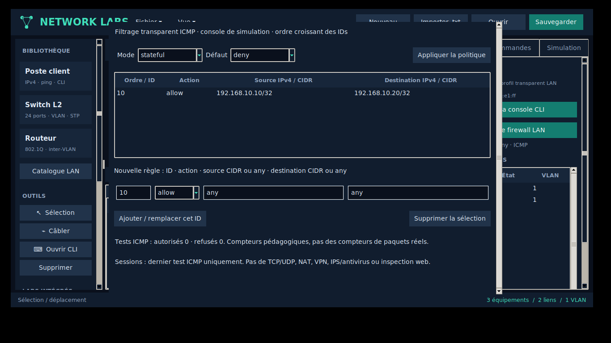

# Firewalls LAN : types et support réel

Le lab **08 Firewall LAN** place un firewall transparent entre un poste Windows
et un NAS. Par défaut, le firewall refuse les tests. Une règle autorise le poste
vers le NAS ; en mode stateful, le retour de ce même test est autorisé. Une
nouvelle initiation depuis le NAS reste refusée.

## Familles

| Type | État | Couverture |
| --- | --- | --- |
| Filtre réseau stateless | Utilisable | Règles IPv4 source/destination, ICMP simulé ; retour explicitement autorisé |
| Firewall réseau stateful | Utilisable | Même filtrage + retour du test ICMP courant autorisé par état |
| Firewall transparent | Utilisable | Deux ports Ethernet dans un même domaine L2 ; pas d'adresse IP de gestion |
| Firewall routé / zones L3 | Référence | Routage, zones et politiques inter-zones à implémenter |
| Firewall hôte | Référence | Politique locale de poste à implémenter |
| NGFW | Référence | Identification applicative, IPS/IDS, inspection TLS à implémenter |
| UTM | Référence | Antivirus, filtrage web et services intégrés à implémenter |
| WAF | Référence | Analyse HTTP et protection applicative à implémenter |
| Proxy applicatif | Référence | Terminaison et analyse des connexions applicatives à implémenter |

Le catalogue propose des identités **Fortinet FortiGate, Palo Alto PA, Cisco ASA,
Netgate pfSense, Deciso OPNsense, Sophos, Check Point Quantum, SonicWall TZ et
Juniper SRX**, plus les modèles génériques. Ces profils partagent le même moteur
transparent ICMP. Ils ne reproduisent pas les systèmes/CLI constructeur ni leurs
fonctions avancées ; sélectionner un FortiGate n'active pas un moteur UTM.
Le catalogue n'est pas une liste exhaustive de tous les modèles commercialisés.

## Configuration

Utiliser **Inspecteur → Politique firewall LAN** ou la console de simulation :

```text
firewall mode stateful
firewall default deny
firewall rule 10 allow 192.168.10.10/32 192.168.10.20/32
show firewall
show firewall sessions
show firewall counters
firewall rule delete 10
```

Les commandes sont propres au simulateur, pas du FortiOS/PAN-OS/ASA/pf.
Les IDs de 1 à 65535 définissent l'ordre croissant. La première règle dont les
réseaux source et destination correspondent décide ; sinon la politique par
défaut s'applique. `any` signifie `0.0.0.0/0`. Un ID existant est remplacé après
validation complète. En mode stateless, créer aussi une règle pour le retour.
Les configurations, interfaces et règles persistent dans JSON et export texte.
Sessions et compteurs sont temporaires, non sauvegardés.

## Limites du modèle

Le contrôle s'applique uniquement aux chemins des tests ICMP IPv4. Il ne filtre
pas de vrais paquets. DNS emploie le contrôle de connectivité ICMP du moteur ;
il n'existe pas de filtrage DNS UDP/53 distinct. DHCP, multicast et protocoles L2
ne passent pas par cette politique ICMP. Ce modèle ne constitue donc pas une
émulation complète de firewall réseau.

L'état est limité à l'aller/retour du test en cours et réinitialisé au prochain
test, sans suivi de connexions TCP/UDP, ports, timers ou séquences. Les compteurs
comptent des décisions de test, pas des paquets réels. Pas de NAT, VPN, haute
disponibilité, routage, inspection L7 ou moteur de sécurité constructeur.
Le bridge utilise le moteur L2 pédagogique partagé (VLAN/STP/ports) ; une route
physique contournant le firewall contourne aussi sa politique.


