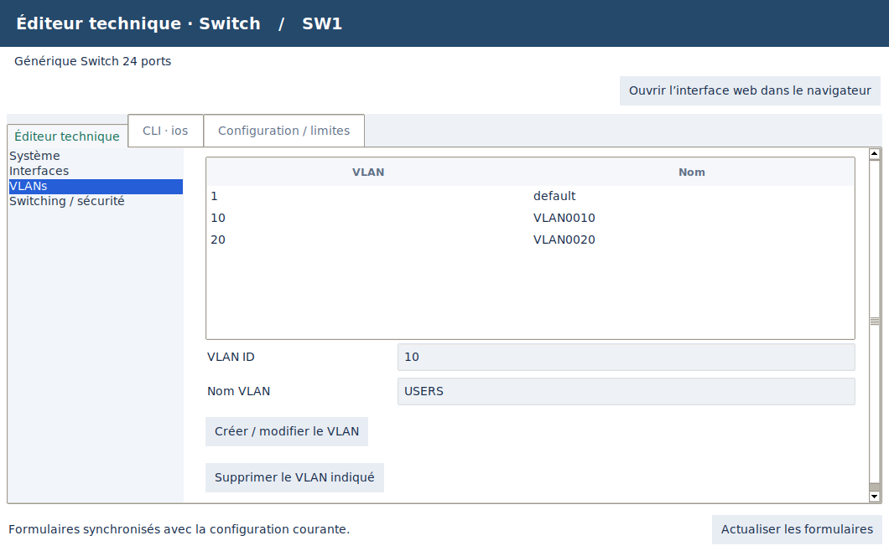
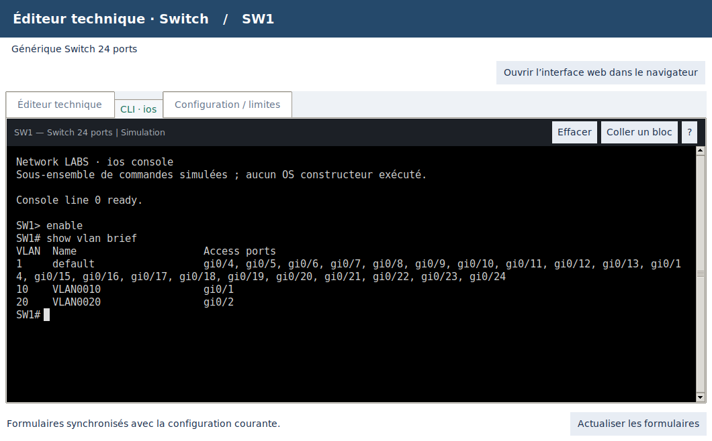
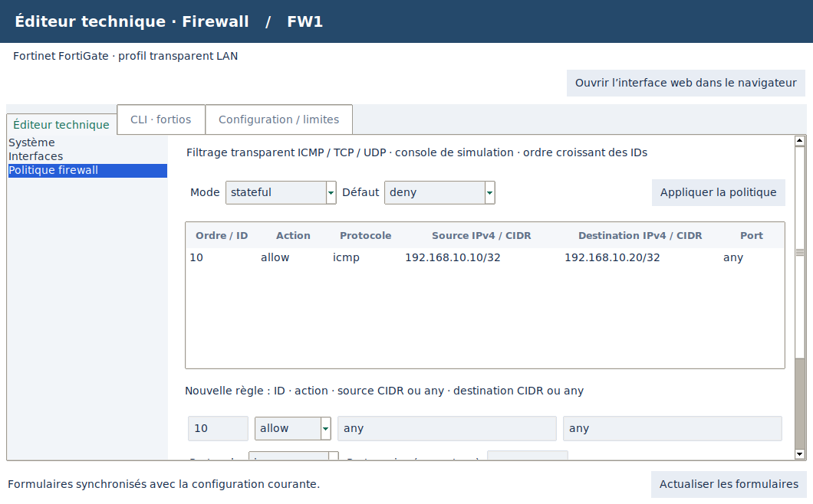

# Configurer un équipement en GUI ou CLI

Pour les formulaires bureau, utiliser **Configuration bureau / CLI** dans
l'inspecteur / menu contextuel. La gestion web est décrite dans [WEB.md](WEB.md). Une fenêtre unique par équipement comporte :

- **Paramètres réseau / Éditeur technique** : navigation par sections, formulaires et tableaux.
- **CLI** : dialecte du profil ou indication de son indisponibilité.
- **Configuration / limites** : état/configuration courante et périmètre du profil.

Les consoles déjà ouvertes dans le dock restent utilisables. Le nom système
et le prompt sont mis à jour sans perdre la saisie en cours. Un double-clic sur
un port ouvre désormais le formulaire Interfaces de cette même fenêtre.

## Couverture des formulaires

| Équipement | GUI disponible |
| --- | --- |
| Tous les profils créables | Nom système, description du périmètre et couverture de console |
| Postes Windows/Linux, portables, imprimantes, NAS, caméras, téléphones IP, IoT | IPv4 statique / DHCP, passerelle, DNS, interface activée/désactivée, test ping par IP/nom |
| Serveur | Réseau endpoint + service DNS, records A et édition graphique |
| Switch L2 | Création/suppression VLAN, ports access/trunk/dynamiques, native/allowed VLAN, état administratif, description |
| Switch L2 : protocoles | Mode STP, priorité par VLAN/instance MST, région/révision/mapping MST, VTP v2 domaine/mot de passe/mode, EtherChannel par port |
| Switch L2 : protections | PortFast/BPDU Guard, port-security maximum/violation, trusted DHCP/DAI, IP Source Guard, AAA/802.1X global et par port, snooping DHCP/IGMP |
| Routeur 802.1Q | Création/modification/suppression des sous-interfaces, CIDR, état administratif ; service DHCP, pools, bail, passerelle/DNS et exclusions |
| Firewall LAN | Interfaces L2 et éditeur intégré de règles, mode stateful/stateless, default allow/deny et compteurs |

Les fonctionnalités non présentes dans un formulaire mais disponibles dans le
moteur restent accessibles par la CLI (ex. MAC sticky explicites et certaines
options avancées). Les références non créables du catalogue n'ont pas de GUI
fonctionnel. Les limites Wi-Fi/voix/vidéo/fichiers/NGFW sont inchangées.

## Validation et synchronisation

Chaque action de formulaire prépare une copie isolée du lab et exécute la
grammaire canonique interne. Les consoles constructeur ont leurs adaptateurs
séparés : voir [FIDELITY.md](FIDELITY.md). L'ensemble est appliqué uniquement après
validation ; un CIDR, VLAN, DNS ou autre paramètre invalide n'applique aucune
partie du formulaire. Les identités des objets utilisés par les consoles et
dialogues existants sont conservées.

Les formulaires propres sont actualisés après un changement CLI. Si vous avez
un brouillon GUI, une modification concurrente affiche un message et bloque
l'application des anciens champs. **Actualiser les formulaires** recharge la
configuration courante et abandonne les champs non appliqués. Les changements
appliqués font partie du lab ; sauvegarder le projet pour les conserver sur disque.

En DHCP, adresse/passerelle/DNS viennent du serveur et les champs statiques sont
ignorés. Désactiver une interface déjà configurée en DHCP conserve son mode.
Une première obtention DHCP exige une interface active et un serveur accessible.
Les politiques firewall filtrent les tests ICMP et les transactions TCP/UDP
simulées par protocole et port. Il n'y a pas d'inspection applicative réelle.

## Fenêtres et navigation

Les dimensions initiales sont limitées à l'écran. Les formulaires longs ont un
défilement vertical ; les boutons et messages restent accessibles sur laptop.
Le prompt de la console suit les sorties, changements d'onglet et redimensionnements.
Changer de lab ou supprimer un node ferme les fenêtres de cet ancien équipement.

