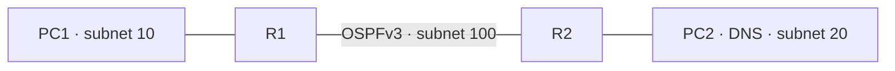

# IPv6 DNS over a physical OSPFv3 pair

`example --ipv6-dns-ospfv3` places one separate managed DNS server PC2
(`2001:db8:20::20`) behind R2. PC1 (`2001:db8:10::10`) uses that server as
its only resolver. R1/R2 learn their remote LAN prefixes through BIRD OSPFv3;
neither router declares static IPv6 routes. Hosts retain static default
gateways. The DNS zone is AAAA-only: `server.lab.test` maps to PC2, A queries
return NODATA, and missing names return NXDOMAIN.



```bash
python3 -m network_labs.appliances rootfs --busybox /usr/bin/busybox \
  --bird /usr/sbin/bird --birdc /usr/sbin/birdc --dnsmasq /usr/sbin/dnsmasq \
  --output /absolute/dns-ospfv3-rootfs
python3 -m network_labs.appliances example --ipv6-dns-ospfv3 \
  --rootfs /absolute/dns-ospfv3-rootfs > ipv6-dns-ospfv3.json
sudo python3 -m network_labs.appliances start ipv6-dns-ospfv3.json
sudo python3 -m network_labs.appliances probe ipv6-dns-ospfv3-lan PC1 \
  server.lab.test --protocol dns --family ipv6 --dns-transport tcp --json
```

Wait for real OSPF convergence and route installation before expecting the
probe to pass. The initial profile requires exactly two physical OCI routers,
one separate IPv6 DNS server and IPv6-only hosts. Every numbered router port
participates in OSPF, with exactly one active transit and passive LAN ports.
Active ports must directly connect, router IDs must differ, and hello/dead
timers must match. Clients may use only the managed DNS resolver. Existing
static IPv6 DNS and standalone OSPFv3 references remain available.

This composition excludes mixed/dual-stack routing, AAA/management, switches,
SVIs, subinterfaces, firewall/security, TFTP/NTP and dynamic address services.
It retains single-area point-to-point OSPFv3 with static interface numbering.
No alternative path, route redistribution, authenticated OSPF, DNS encryption,
DNSSEC, recursion or dynamic DNS registration is added.

The dedicated native scenario requires Full adjacencies and bidirectional
remote LAN routes with BIRD protocol and link-local gateways, actual OSPFv3
and UDP/TCP DNS packets, AAAA/A-NODATA/NXDOMAIN and a managed DNS probe. DNS
outage must leave OSPF routes and routed echo working. Stopping R2's routing
daemon must withdraw R1's remote route and break remote DNS while both DNS
transports still work directly from R2 to the live server. Restart must
reconverge without inserting a static service route. Static-route and DNS/BIRD
config drift must refuse save. Cold restore must retain only declared OSPF
policy and host gateways, then learn routes and serve DNS afresh. Host network
invariants are checked. Exact evidence is recorded in LAN_NEXT_STEPS.md.

Selected regressions cover standalone physical/SVI OSPFv3, static tagged IPv6
DNS, physical dual-stack DNS and general CI. Local skips are not native proof.

```bash
gh workflow run tests.yml --ref handoff/codex-dot1x-2026-11-04 \
  -f suite=ipv6-dns-ospfv3
```

Remaining LAN work precedes GUI. Static VXLAN with explicit VTEP/VNI/VLAN
mapping remains required; EVPN/BGP remains separate later work.
