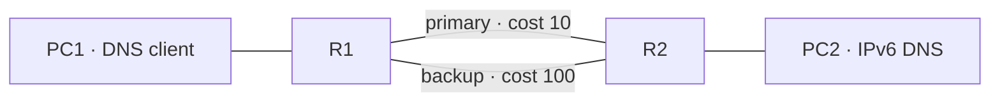

# Costed OSPFv3 path failover for IPv6 DNS

`example --ipv6-dns-ospfv3-failover` adds a second physical transit to the
existing two-router IPv6 DNS reference. The primary uses subnet 100, R1 eth1
and R2 eth0 at cost 10. The backup uses subnet 200, eth2 on both routers at
cost 100. PC1 remains on subnet 10 and DNS PC2 on subnet 20. Both routers
declare no static routes; hosts retain their default gateways.



Build the combined BIRD/dnsmasq rootfs as in
[IPV6_DNS_OSPFV3.md](IPV6_DNS_OSPFV3.md), then:

```bash
python3 -m network_labs.appliances example --ipv6-dns-ospfv3-failover \
  --rootfs /absolute/dns-ospfv3-rootfs > ipv6-dns-ospfv3-failover.json
sudo python3 -m network_labs.appliances start ipv6-dns-ospfv3-failover.json
sudo python3 -m network_labs.appliances probe ipv6-dns-ospfv3-failover-lan PC1 \
  server.lab.test --protocol dns --family ipv6 --dns-transport tcp --json
```

Validation permits one or two directly paired active transits on the same two
physical routers, with every numbered port in OSPF and LAN ports passive.
For two transits, each link's endpoint costs must match and the two links
must have distinct costs. Router IDs remain distinct and timers match. The
existing single-transit reference retains its policy, including independently
configured endpoint costs. BIRD's existing `ecmp no` remains in place.

The profile retains one separate managed IPv6 DNS server and its explicit
resolver clients, static IPv6 numbering, single-area point-to-point OSPFv3,
and all existing exclusions for mixed/AAA, switching/SVIs/subinterfaces,
firewall/security, other services and dynamic addressing. The reference zone
remains AAAA-only. It adds neither ECMP, a larger router graph, redistribution,
OSPF authentication nor zero-loss or fixed-time convergence guarantees.

The dedicated native test injects temporary bidirectional ingress IPv6 drops
on selected owned transit interfaces using tc flower/clsact. Admin state and
carrier remain UP; positive drop counters prove an actual packet blackhole.
These are virtual link faults, not cable-pull, every-kernel or arbitrary
one-way fault coverage. No runtime fault-injection API is added.

Native proof requires both Full adjacencies and the lower-cost FIB selection,
then primary loss with automatic backup selection and working UDP/TCP DNS.
Both-path capture checks require DNS packets only on the selected path.
Restoring the primary must prefer it again. Losing both transits must withdraw
both remote LAN routes and break routed DNS while DNS remains independently
available on R2's directly connected LAN. Restoring only the backup must
recover service with the primary still blocked. Router/DNS PIDs and declared
state remain unchanged; no address/route injection or daemon restart repairs
the path. Drift controls use an unrelated static prefix and changed BIRD file.

The tc rules are external test faults, outside the managed/save audit. Saving
with service on the backup exports only declared policy; cold restore creates
fresh namespaces without those rules and relearns both adjacencies, selecting
the primary. Restored qdiscs must match their original baselines. This does
not claim save detects arbitrary tc changes or snapshots learned routes.
Host network invariants are checked. Exact evidence is in LAN_NEXT_STEPS.md.

```bash
gh workflow run tests.yml --ref handoff/codex-dot1x-2026-11-04 \
  -f suite=ipv6-dns-ospfv3-failover
```

Selected regressions cover single-transit DNS/OSPFv3, standalone physical/SVI
OSPFv3 and general CI. Remaining LAN work precedes GUI. Static VXLAN with
explicit VTEP/VNI/VLAN mapping remains required; EVPN/BGP remains separate.
