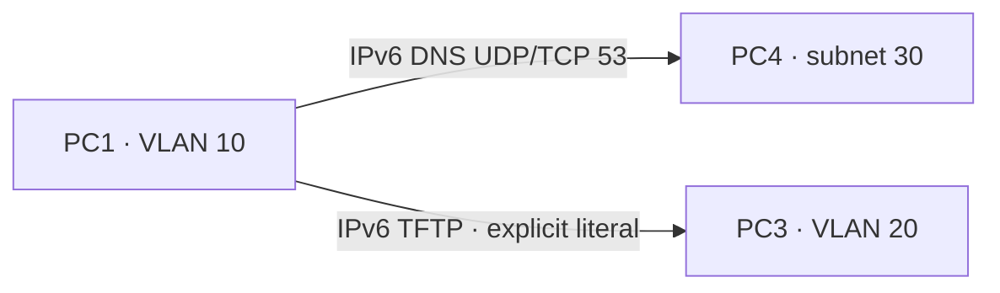

# Separate IPv6 DNS and TFTP services

`example --ipv6-dns-tftp` combines one managed IPv6-only DNS server PC4
(`2001:db8:30::10`) and one separate read-only IPv6 TFTP server PC3
(`2001:db8:20::10`). PC1 uses PC4 as its explicit resolver. The AAAA-only zone
maps `files.lab.test` to PC3, with A/NODATA for that name and NXDOMAIN for
missing names. R1 uses static ROAS VLANs 10/20 and VLAN-100 transit to R2.



These arrows show service flows, not direct physical cables. DNS crosses
R1/R2 on VLAN 100; TFTP crosses R1 into VLAN 20. Both use VLAN 10 at PC1.
The underlying switch and router topology remains the existing static tagged
reference. DNS replies describe an address; they do not establish that the
TFTP service is running or that its file content is trustworthy.

Build the dnsmasq-capable rootfs as in [IPV6_TFTP.md](IPV6_TFTP.md), then:

```bash
python3 -m network_labs.appliances example --ipv6-dns-tftp \
  --rootfs /absolute/rootfs-tftp > ipv6-dns-tftp.json
sudo python3 -m network_labs.appliances start ipv6-dns-tftp.json
sudo python3 -m network_labs.appliances probe ipv6-dns-tftp-lan \
  PC1 files.lab.test --protocol dns --family ipv6 --dns-transport tcp --json
sudo python3 -m network_labs.appliances tftp-read ipv6-dns-tftp-lan \
  PC1 2001:db8:20::10 sample.bin --family ipv6 --block-size 1024 --json
```

The two commands are separate observations. TFTP still requires an explicit
IP literal; no automatic DNS lookup, name-to-transfer binding, family fallback
or cached resolver result is added. DNS outage therefore leaves direct-IP
TFTP independent. TFTP outage leaves DNS data available.

`--tftp-file NAME=PATH` can import bounded public binary assets. Existing
TFTP source/peer binding, finite retries, SHA-256 checks, eight-file and 64-KiB
binary limits remain; no writes, authentication, encryption or received-file
persistence are added. DNS retains its bounded static-zone and probe behavior.
When DNS is configured alongside IPv6 TFTP, exactly one separately managed
IPv6 DNS server is required and any client resolver list must contain only
that server's bound address. TFTP nodes have no resolver policy. Resolver-only,
external/alternate resolver and cohosted DNS/TFTP profiles remain refused.

This composition requires static IPv6-only physical hosts/routers or existing
static dot1Q routers and Linux VLAN switches. Mixed/dual-stack, SVIs, dynamic
IPv6, STP/bundles, AAA, NTP and firewall/security combinations remain excluded.
Standalone DNS and TFTP references keep their existing behavior.

The dedicated native scenario requires concurrent DNS/TFTP observations,
UDP/TCP AAAA and A/NODATA, NXDOMAIN, separate listener observations, actual
tagged request/reply captures for both services, hash-checked binary transfers,
independent service outages/recovery, independent route and VLAN pruning
controls, drift refusal for both service configs, saved declarations, cold
restore and host network invariants. Selected regressions cover standalone
tagged DNS/TFTP and general CI. Exact results are in LAN_NEXT_STEPS.md.

```bash
gh workflow run tests.yml --ref handoff/codex-dot1x-2026-11-04 \
  -f suite=ipv6-dns-tftp
```

Remaining LAN work precedes GUI. Static VXLAN with explicit VTEP/VNI/VLAN
mapping remains required; EVPN/BGP remains separate later work.
