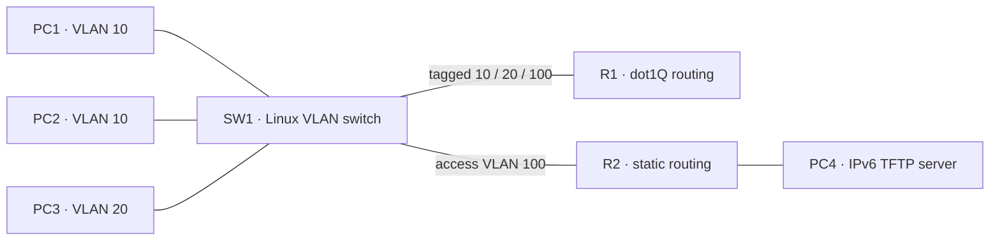

# IPv6 read-only TFTP over VLANs and router subinterfaces

`example --ipv6-tftp-subinterfaces` places a separate IPv6 TFTP server PC4
(`2001:db8:30::10`) behind the existing ROAS and two-router static topology.
PC1/PC2 use VLAN 10, PC3 uses VLAN 20, and R1 reaches R2 through VLAN 100.
R1's physical parent remains unnumbered; all three dot1Q children and other
host/router physical ports require explicit static IPv6. The physical-only
`--ipv6-tftp` reference and IPv4 defaults remain available.



Build the dnsmasq-capable rootfs as in [IPV6_TFTP.md](IPV6_TFTP.md), then:

```bash
python3 -m network_labs.appliances example --ipv6-tftp-subinterfaces \
  --rootfs /absolute/rootfs-tftp > ipv6-tftp-roas.json
sudo python3 -m network_labs.appliances start ipv6-tftp-roas.json
sudo python3 -m network_labs.appliances tftp-read ipv6-tftp-subinterfaces-lan \
  PC1 2001:db8:30::10 sample.bin --family ipv6 --block-size 1024 --json
```

`--tftp-file NAME=PATH` embeds explicitly selected public files. The existing
read-only protocol limits, source/peer binding, hash checks and bounded retries
remain unchanged: eight files, 64 KiB per binary file, no writes, authentication,
encryption, DNS/family fallback or received-file persistence. This composition
excludes SVIs, STP, bundles, dynamic IPv6, IPv4 addressing/routing and other
services/security policies. It does not establish generic MTU interoperability.

The dedicated native scenario requires actual request/reply traffic on tagged
VLANs 10 and 100, successful clients on VLANs 10 and 20, binary/empty/exact/
64-KiB transfers with hashes, negotiated/classic blocks, wrong-hash/missing-file
failures, service/forwarding/route/VLAN-pruning outage and recovery, independent
same-VLAN delivery, a live local server control during forwarding loss,
drift-save refusal, retained declarations after cold restore and unchanged host
network invariants. The selected suite also runs physical IPv6 TFTP, IPv4 TFTP,
static IPv6 subinterface regressions and general tests. Native evidence, when
complete, is recorded in LAN_NEXT_STEPS.md; local skips are not native proof.

```bash
gh workflow run tests.yml --ref handoff/codex-dot1x-2026-11-04 \
  -f suite=ipv6-tftp-subinterfaces
```

LAN work continues before GUI. Static VXLAN with explicit VTEP/VNI/VLAN
mapping remains required roadmap work, with EVPN/BGP separate later work.
