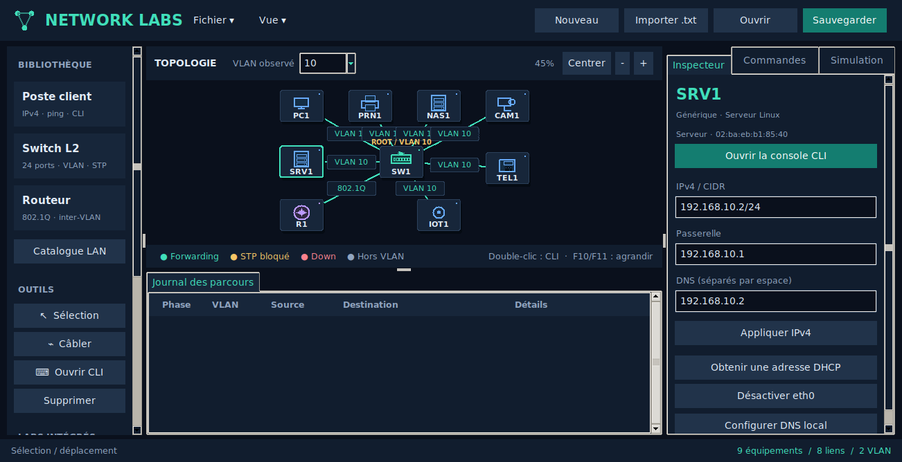
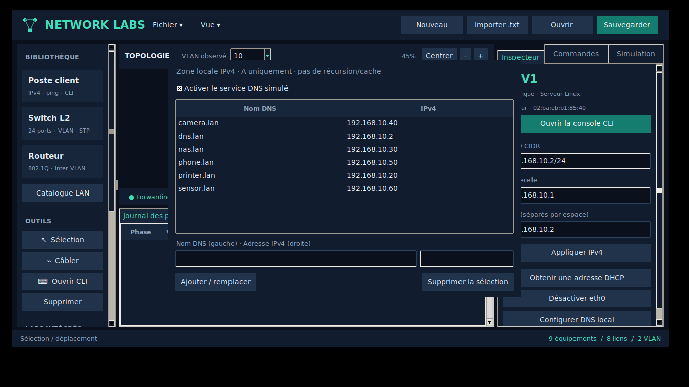

# LAN : couverture réelle du simulateur

Le lab intégré **07 LAN entreprise** (ou `examples/enterprise_lan.lab.txt`)
contient 7 endpoints, un Catalyst 2960 pédagogique et un routeur DHCP/inter-VLAN. Le lab 09 ajoute des services et règles TCP/UDP.
Le catalogue se filtre par rôle et par texte. Les profils sont enregistrés dans
les sauvegardes et imports texte. Les noms commerciaux identifient les profils ;
ils ne chargent aucun firmware ni système constructeur.

| Rôle | Profils utilisables | Simulation disponible | Non implémenté |
| --- | --- | --- | --- |
| Poste / portable | Windows 10/11, Ubuntu/Debian/Rocky, portable générique | IPv4, DHCP, DNS client, interface up/down, ping, accès VLAN | OS complet, applications, radio |
| Serveur | Linux générique, Windows Server | Fonctions endpoint + DNS local A | AD, HTTP, FTP, SMB/NFS, DNS récursif |
| Imprimante | Générique, HP LaserJet Pro 4002dn | Un adaptateur Ethernet, IPv4/DHCP/DNS/ping | Impression, consommables, interface HP |
| NAS | Générique, Synology DS224+ | Un adaptateur Ethernet, IPv4/DHCP/DNS/ping | DSM, fichiers, disques, agrégation/multi-interface |
| Caméra | Générique, Axis P3265-LVE | Un adaptateur Ethernet, IPv4/DHCP/DNS/ping | Vidéo/RTSP, alimentation PoE |
| Téléphone IP | Générique, Yealink SIP-T54W | Un adaptateur Ethernet, VLAN data, IPv4/DHCP/DNS/ping | SIP/RTP, voix, voice VLAN, port PC passthrough, Wi-Fi/PoE |
| IoT | Capteur Ethernet générique | IPv4/DHCP/DNS/ping | MQTT, capteurs physiques, radio |
| Switch | Générique, Cisco 2960/9200L pédagogiques | Moteur L2 partagé : VLAN, STP, EtherChannel et protections documentées | Firmware exact et variantes matérielles exhaustives |

Les endpoints spécialisés ont une **console de simulation LAN**, pas une CLI
constructeur inventée. `show device` décrit le profil et ses limites.
Le serveur Linux/Windows dispose d'un sous-ensemble de commandes réseau OS.

## DNS local

Sur un profil Serveur, utiliser le bouton **Configurer DNS local** ou :

```text
service dns
dns record printer.lan 192.168.10.20
dns record nas.lan 192.168.10.30
show dns records
no dns record nas.lan
no service dns
```

Sur un endpoint :

```text
ip dns 192.168.10.2
nslookup printer.lan
nslookup printer.lan 192.168.10.2
ping printer.lan
```

Le serveur doit avoir une adresse unique, un service actif et un trajet IPv4
aller-retour accessible. Une réponse négative locale renvoie NXDOMAIN. Les
serveurs DNS alternatifs sont essayés en cas de serveur absent/inaccessible ;
pas après NXDOMAIN. Les noms sont normalisés en minuscules, point final accepté.
Le modèle utilise des enregistrements A, sans paquets UDP/TCP, cache, TTL,
transfert de zone, suffixe de recherche, CNAME, DNSSEC ou récursion Internet.
La vérification de transport emploie le même moteur de chemins aller-retour et une transaction UDP/53, avec contrôle firewall par protocole/port.

## Couverture à compléter

Le catalogue n'est pas exhaustif. AP/Wi-Fi, WLC, hubs et switches L3/SVI restent
consultables comme références mais non créables. Les références Aruba, Juniper,
Huawei, Arista, MikroTik et firewalls n'ont pas encore leur moteur/CLI natif.
Les étapes LAN restantes incluent association Wi-Fi/SSID/sécurité, voice VLAN et
passthrough téléphone, PoE, SVI/L3, services applicatifs et adaptateurs CLI par
famille de constructeur. Une nouvelle identité de modèle ne suffit pas à
implémenter ces comportements.

## Références des modèles représentatifs

Les caractéristiques complètes des produits ne sont pas celles de la simulation :

- [HP LaserJet Pro 4002dn](https://www.hp.com/ie-en/products/printers/product-details/product-specifications/35911602)
- [Synology DS224+](https://www.synology.com/en-us/products/DS224%2B) : deux ports réels ; un seul dans notre modèle.
- [Axis P3265-LVE](https://www.axis.com/products/axis-p3265-lve/support)
- [Yealink SIP-T54W](https://support.yealink.com/docs/sip-t54w/yealink-sip-t54w-datasheet/58992982bf3248b19951ea1d9afa053c) : fonctions téléphoniques et deuxième port exclus du modèle.




Les firewalls transparents ICMP/TCP/UDP disposent désormais d'un moteur utilisable :
voir [types et couverture firewall](FIREWALLS.md). Leurs CLI constructeur et
fonctions NGFW/UTM/WAF restent distinctes et non implémentées.
