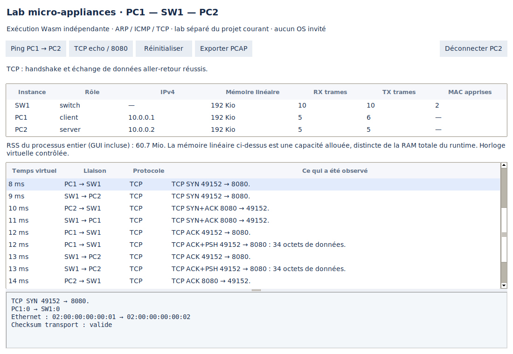

# Micro-appliances exécutables — prototype facultatif

Ce lab expérimental exécute trois instances WebAssembly indépendantes : un
client PC1, un switch SW1 et un serveur PC2. Chaque instance possède sa mémoire
et son état. Les endpoints exécutent **smoltcp 0.14.0**, une pile réseau Rust ;
le switch apprend et commute les adresses MAC dans son propre code invité.

Il s'agit d'une machine d'exécution Wasm, **sans noyau Linux/Windows invité,
firmware constructeur ni virtualisation matérielle**. L'expérience établit la
faisabilité de petites appliances réseau autonomes. Elle ne transforme pas encore
les équipements du projet principal en appliances exécutables.

## Installation et essai

Depuis une copie du dépôt, avec Python 3.12+ :

```bash
git switch prototype/linux-simulator
git pull --ff-only
python3 -m venv .venv-micro
.venv-micro/bin/python -m pip install -r experiments/micro_appliances/requirements.txt
.venv-micro/bin/python -m network_labs.micro_appliances demo
```

Sous Ubuntu/Debian, installer `python3-venv` si la création du venv le demande.
Wasmtime **49.0.0** est facultatif ; le logiciel habituel conserve son lancement
sans dépendance pip. L'artefact Wasm compilé est fourni : Rust n'est pas nécessaire
pour essayer le lab.

Pour la fenêtre graphique, installer `python3-tk` et lancer depuis une session
graphique Linux :

```bash
.venv-micro/bin/python -m network_labs
```

Ouvrir **Fichier → Lab micro-appliances (expérimental)**. Les boutons lancent
un ping, un échange TCP sur 8080, déconnectent/reconnectent PC2, réinitialisent
les instances ou exportent une capture. La table montre les trames réellement
émises et leur explication ; sélectionner une ligne affiche MAC, checksum et
charge utile. Le projet courant est conservé. La connexion TCP unique nécessite
une réinitialisation pour rejouer une nouvelle connexion.



## Ce qui s'exécute

Le runtime Python partage le module compilé mais crée un Store, une instance et
une mémoire Wasm par équipement. Il transporte des **octets Ethernet** entre
ports câblés et fournit une horloge virtuelle. Il ne répond pas à ARP/ping, ne
termine pas TCP, ne maintient pas la table MAC et ne calcule pas un résultat de
connectivité global.

- PC1 émet une requête ARP ; PC2 répond depuis sa pile réseau.
- SW1 apprend les MAC sources et diffuse ou commute les trames.
- Le ping utilise ICMP avec contrôle de l'adresse, de l'identifiant, de la
  séquence et des données attendues.
- TCP réalise SYN, SYN/ACK, ACK puis transporte les données jusqu'au serveur
  d'écho. Un test supprime le premier SYN/ACK et vérifie la retransmission.
- Les checksums IPv4/ICMP/TCP sont vérifiés sur les octets capturés. Un port TCP
  fermé produit un RST ; une liaison débranchée empêche la livraison.

Le seul import invité est `lab.emit`. Aucun WASI, socket hôte, fichier,
sous-processus ou accès réseau externe n'est fourni aux invités. Les IP virtuelles
ne sont pas ajoutées aux interfaces Linux de l'utilisateur.

## Isolation et limites de ressources

Chaque Store dispose d'une limite de **2 Mio de mémoire linéaire** et de
**2 millions d'unités de fuel par appel**. Le fuel borne l'exécution Wasm par
appel ; ce n'est ni un nombre de millisecondes ni une limite de RAM totale du
processus. Les allocations du runtime, du code compilé, de Python et de Tk
s'ajoutent à la mémoire linéaire.

L'expérience d'isolation vérifie qu'une écriture dans PC1 ne modifie pas PC2,
qu'une croissance mémoire excessive est refusée et qu'une boucle infinie est
interrompue. PC2 et PC3 continuent à communiquer via SW1 après la panne de PC1.
Un trap met l'instance concernée en quarantaine jusqu'à la réinitialisation.

Les files NIC sont limitées à 32 trames, la table MAC à 256 entrées, la file
d'événements à 8 192 éléments et une exécution à 100 000 événements. La capture
conserve au maximum 20 000 observations et compte les observations abandonnées.
Ces bornes sont celles du prototype, pas une garantie de performance générale.

## Mesures reproductibles

```bash
.venv-micro/bin/python -m network_labs.micro_appliances demo --json /tmp/micro-demo.json --pcap /tmp/micro-demo.pcap
.venv-micro/bin/python -m network_labs.micro_appliances isolation
.venv-micro/bin/python -m network_labs.micro_appliances benchmark --sizes 10 50 100 --json /tmp/micro-benchmark.json
```

Mesures du 20 octobre 2026 dans l'environnement d'exécution Linux x86_64,
Python 3.12.14, Wasmtime 49.0.0. **Ce ne sont pas des mesures sur le PC de
l'utilisateur.** Chaque taille démarre dans un processus neuf, sans GUI et
sans conservation des captures, avec un switch supplémentaire. Chaque client
ping le dernier endpoint, puis PC1 effectue un échange TCP.

| PC + switch | Ping réussis | TCP | RSS processus | PSS processus | Capacité mémoire linéaire | CPU trafic |
| --- | --- | --- | --- | --- | --- | --- |
| 10 + 1 | 9/9 | OK | 40,74 Mio | 38,13 Mio | 2,06 Mio | 0,017 s |
| 50 + 1 | 49/49 | OK | 42,60 Mio | 39,82 Mio | 9,56 Mio | 0,242 s |
| 100 + 1 | 99/99 | OK | 44,59 Mio | 41,63 Mio | 18,94 Mio | 0,941 s |

RSS inclut les pages résidentes partagées ; PSS les répartit entre processus.
La capacité linéaire est une allocation virtuelle, pas une mesure de pages
résidentes. Les valeurs ne s'additionnent pas. Les JSON conservent aussi les
mesures avant compilation, après compilation et après instanciation. La taille
de l'espace d'adressage virtuel inclut les réservations Wasmtime et ne représente
pas la RAM consommée. Dans la fenêtre, le RSS inclut aussi toute la GUI.

Le relevé CPU au repos dure 0,2 s **avec l'horloge virtuelle en pause** ; il ne
mesure pas un réseau temps réel actif. Le transport ajoute 1 ms virtuelle par
liaison : ni le temps affiché ni le temps CPU ne sont un RTT matériel mesuré.

Les [résultats JSON et la capture de référence](../experiments/micro_appliances/results/)
correspondent à l'artefact identifié dans
[`build.json`](../network_labs/micro_appliances/build.json). La capture PCAP
Ethernet contient les observations de sortie des ports connectés : une même
trame peut apparaître sur plusieurs liaisons. Ses timestamps démarrent à zéro
et suivent l'horloge virtuelle.

## Périmètre actuel et suite

Un LAN Ethernet non tagué, IPv4 /24 statique, une NIC par endpoint, apprentissage
MAC sans vieillissement, ICMP et une connexion TCP d'écho sur 8080. Les charges
utiles de commande sont limitées à 512 octets. Le générateur accepte de 2 à 254
endpoints ; les mesures publiées vont jusqu'à 100.

Il n'y a pas encore de routeur, firewall, VLAN/STP, DHCP, DNS, routage dynamique,
CLI constructeur ou OS Windows/Linux dans ces instances. Ces fonctions présentes
dans le moteur pédagogique principal ne sont pas automatiquement transférées
dans ce prototype. La GUI Windows/Linux existante reste une interface du
simulateur, pas un bureau de système invité.

La prochaine étape est de stabiliser une API de configuration par appliance,
puis de porter VLAN et routage IPv4, avec des tests de trames avant d'ajouter
le filtrage firewall. WAMR, Unikraft et Firecracker ne sont pas implémentés ni
comparés par ce benchmark ; aucun gain relatif n'est revendiqué.

## Sources et reconstruction

Le guest est dans `experiments/micro_appliances/guest/`. Pour reproduire la
compilation de référence, installer Rust 1.91.1 avec le target
`wasm32-unknown-unknown`, puis depuis la racine :

```bash
rustup target add wasm32-unknown-unknown --toolchain 1.91.1
RUSTUP_TOOLCHAIN=1.91.1 python3 experiments/micro_appliances/build_guest.py
```

Le script utilise le lockfile Cargo et régénère l'artefact, son SHA-256 et le
manifeste des sources. Le test du manifeste signale toute divergence. La feature
smoltcp `auto-icmp-echo-reply` est explicitement activée. Les licences du code
embarqué sont dans `experiments/micro_appliances/THIRD_PARTY_NOTICES.txt` et
`experiments/micro_appliances/licenses/rust-stdlib.html`.

Références : [Wasmtime](https://docs.wasmtime.dev/),
[limites mémoire](https://docs.wasmtime.dev/api/wasmtime/struct.StoreLimitsBuilder.html),
[fuel](https://docs.wasmtime.dev/api/wasmtime/struct.Config.html#method.consume_fuel),
[smoltcp](https://github.com/smoltcp-rs/smoltcp).
