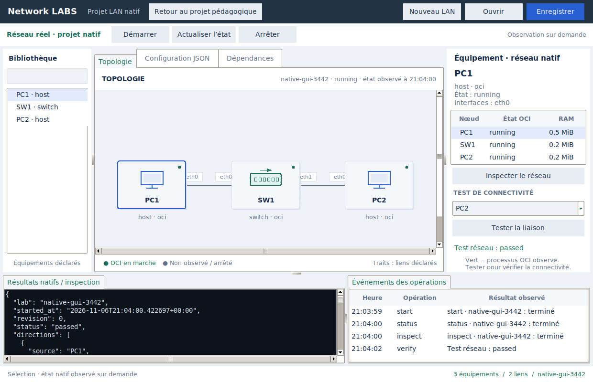
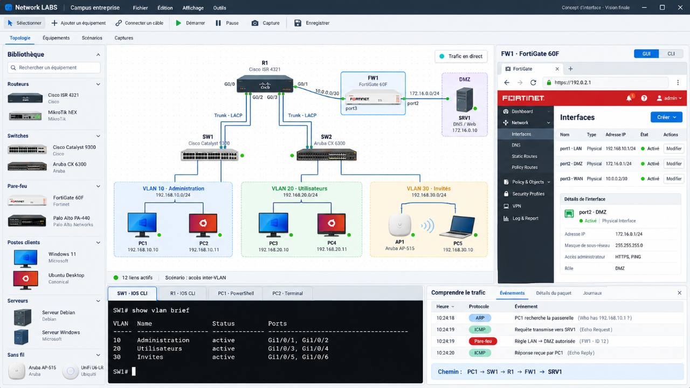

# Native GUI lifecycle and observations

The native workbench now has a topology view and a real backend result path.
Open it from the desktop's existing native-lab entry. It uses the agreed
main-window layout while keeping native state separate from the educational
canvas and Wasm backend. Returning restores their existing project and engine.

## First usable flow

1. Prepare a native BusyBox rootfs using the existing appliance guide, then
   choose **Nouveau LAN** (name/rootfs) or open an existing native manifest.
2. Review the generated nodes/links. JSON configuration remains available;
   **Valider / plan** validates it offline and redraws the declared topology.
3. **Démarrer** saves a private project and sends a private per-operation
   manifest snapshot to the real backend. Confirm sudo in the external terminal.
4. **Actualiser l’état** shows actual OCI process states and per-node cgroup
   RAM. Select a node and **Inspecter** for kernel links/addresses/routes.
5. Select an OCI host and destination and choose **Tester liaison** for a
   bounded, bidirectional native IPv4 ICMP verification. Failed/blocked tests
   remain failures; a running process is not proof of network delivery.
6. **Arrêter** updates the view only after backend teardown is confirmed.

The graph is the selected manifest before observation and the backend's
public running topology after a response. Edges are declared links, not
simulated packet delivery. Green indicates an observed running OCI process;
unknown/unobserved and Firecracker guest readiness are not marked running.
Observations are snapshots requested by the user, not continuous monitoring.
Status/stop/inspect use the displayed lab even if the JSON editor is invalid.

## Privilege and result handling

The desktop stays unprivileged. An unprivileged terminal wrapper authenticates
with `sudo -v` using the terminal's real input/error streams, then invokes a
fixed typed backend with `sudo -n`. Only start/status/stop/inspect and bounded
verify operations are accepted. No shell command string is constructed.
The backend uses the existing native Manager/locks and returns a public
topology and redacted observations; rootfs/private credential policies remain
in the existing engine.

Only the unprivileged wrapper writes GUI results. Each request/result has a
unique context and lives in a private user directory with mode-0600 JSON.
Manifest saves use private atomic replacement. Stale/mismatched/public result
files and malformed backend replies do not produce a success state. The GUI
does not collect passwords, elevate itself or write result paths as root.

Opening a different project changes the displayed lab without stopping other
labs. Closing the window does not stop a running lab or cancel privileged
operations. If the terminal closes without a result, a five-minute UI wait
limit reports uncertainty and permits a fresh status request; it never kills
the privileged operation or assumes teardown. Explicit Stop remains required.

## Scope and validation

This is the first native GUI vertical slice: automatic topology view, basic
LAN creation, JSON configuration, lifecycle, runtime observations and a real
connectivity check. Canvas node/link editing, full per-device configuration
forms, embedded consoles/capture workflows, broader project management and
desktop/hardware acceptance remain later GUI work. LAN core remains closed;
advanced LAN extensions must not become new prerequisites.

Unit/Tk tests cover private transport, sudo ordering, typed argv, canceled
authentication, bad/stale results and honest visual states. The dedicated
native GUI test runs Tk as the normal hosted-runner user, uses the actual
sudo/backend and OCI packets, verifies private result ownership and confirms
stop/host cleanup. Only external-terminal presentation is replaced for CI's
passwordless sudo; interactive password-prompt UX still needs a real desktop.
It retains a screenshot and JSON evidence.

At implementation `cad63774a58a9d51aa3b73bc28d90b932fb7fc86`, the
[desktop/native job](https://github.com/sou1915/Network-LABS/actions/runs/42267670327/job/128063724857)
passed general regression (1033 cases, 47.405 seconds, 116 environment/opt-in
skips) and the separate real GUI/native scenario (4.207 seconds). Tk ran as
UID 1001; all six result files were written by UID 1001, and direct root-state
access was refused. The actual sudo backend created three OCI nodes/two links,
returned runtime status/kernel inspection, verified bidirectional native ICMP,
confirmed stop and handled a subsequent failed status without false success.
No callback errors or namespace/link/IPv4/IPv6 route/rule leaks remained.
Only terminal presentation was substituted for passwordless CI; kernel,
Manager, sudo and traffic were real. Interactive password-prompt UX remains
manual desktop acceptance.

All ten selected jobs in run 42267670327 passed, including `lan-core-ready`;
52 other profiles were intentionally skipped. Local full tests passed 1033
cases in 30.030 seconds with 166 environment skips. Compilation, workflow
structure, diff and documentation-link checks passed. No failed native run
preceded this GUI increment. LAN protocol behavior was unchanged.

## Captured GUI evidence

This is the actual Xvfb capture after real native verification.
The public [operation report](images/native-gui-result.json) records the UI UID,
result-file owners, native probe and stop outcome. The
[provenance record](images/native-gui-provenance.json) binds both screenshots and the report to
artifact 13550324801, source commit and run/job, with the verified original ZIP
SHA-256 and individual file hashes. The desktop/native job passed on the same commit.

## Previous desktop layout (rejected as the design reference)

The native LAN now uses the existing [workspace design](workspace_design.png):
light theme, equipment list on the left, topology in the centre and inspector
on the right. Device cards reuse the desktop's own icons and shared colours.
Opening native LAN replaces the visible workspace inside the main window;
**Retour au projet pédagogique** restores the previous project and its save
shortcut without changing its backend. Switching views does not stop a lab.
Native process state and connectivity results still come from the real backend.
The inspector keeps the result of a connectivity check visible beside the graph.

This corrects the previous separate technical-window presentation. The left
list selects existing native devices; graphical creation/cabling and full
per-device forms remain pending. JSON, dependencies and detailed observations
are available as central tabs. This is alignment with the agreed layout, not
completion of all GUI editing workflows.

At source `a82b0571194f81759e29bf6e50d8e5b65dfd8664`, the
[desktop/native job](https://github.com/sou1915/Network-LABS/actions/runs/42276785462/job/128095032017)
passed 1033 regression cases in 47.945 seconds (116 environment/opt-in skips).
The real native GUI test passed in 4.466 seconds using the actual main App and
embedded native workspace, including return to the preserved model project.
It verified three running OCI devices, kernel inspection, bidirectional ICMP,
six private user-owned responses, direct root-state denial and confirmed
teardown without callback errors or host-network leaks. The screenshot and
report above now show this embedded layout rather than the earlier window.
Local full regression passed 1033 cases in 30.311 seconds (166 skips, including
Tk because the local environment has no display); desktop execution was
verified in CI. Interactive password-prompt and hardware acceptance remain open.

The same source also passed all ten selected jobs in
[run 42276785462](https://github.com/sou1915/Network-LABS/actions/runs/42276785462),
including the [7/7 LAN aggregate](https://github.com/sou1915/Network-LABS/actions/runs/42276785462/job/128097531781).
The dedicated wired 802.1X job passed managed-peer recovery (55.167 s) and
independent-supplicant admission/revocation (219.122 s); 52 other profiles were
intentionally skipped. The superseded run 42276666855 was canceled after the
explicit desktop-entry correction, not used as final validation evidence.

## User-supplied target design

This is the user's target mockup, not an implementation screenshot. It
supersedes workspace_design.png and enterprise_lan.png as the visual target.
The current native workbench has verified backend functionality but does not
implement this design yet. See CODEX_HANDOFF.md for the required layout and
capability boundaries.

## Reference shell implementation

The first increment toward the supplied mockup adds a compact dark title bar,
a central topology/technical notebook, a resizable bottom dock for real native
results, and a neighbouring operation-event table. The project equipment list
supports case-insensitive search by name, role or runtime. Redrawing or loading
a project preserves the search without leaving hidden stale equipment entries.

Events record received backend operation outcomes, including failures; they
are not packet capture events. The dark results dock displays real inspection
and probe JSON, not an interactive vendor CLI. Device thumbnails, VLAN/DMZ
visual groups, graphical editing, embedded device forms/interactive consoles
and packet-event integration remain pending. The supplied mockup is still the
target, and this increment is not visual completion or a firmware replica.

Final shell source `d18df0909839b28a223cdd8835fbacce0d1f970d` passed the
[desktop/native job](https://github.com/sou1915/Network-LABS/actions/runs/42293363242/job/128152218260):
1034 regression cases in 45.238 s (116 environment/opt-in skips), plus the
real embedded GUI / sudo / OCI scenario in 4.079 s. The latter verifies the
connectivity button remains visible above the dock at 1240×800, four actual
operation events after verification, real bidirectional ICMP, private results,
confirmed stop, preserved model project and no callback/host-network leaks.
The screenshot/report/provenance now correspond to artifact 13540452917.
The earlier shell passed its desktop/native test too; its screenshot exposed
clipped controls, which the final source corrects. Local general regression
passed 1034 cases in 30.402 s (167 environment skips, including display tests).

All ten selected jobs on final shell source passed in
[run 42293363242](https://github.com/sou1915/Network-LABS/actions/runs/42293363242),
including wired 802.1X and the
[7/7 LAN aggregate](https://github.com/sou1915/Network-LABS/actions/runs/42293363242/job/128154680651).
The other 52 profiles were intentionally skipped. The initial shell also
passed all ten selected jobs in run 42293016742. No native runtime behavior or
protocol assertions were changed for this GUI increment.

## Graphical topology editing

**Ajouter** creates a generic OCI Linux host, switch or router with an explicit
rootfs, name, 1–16 initial ports and optional IPv4/CIDR on eth0. Use empty
physical addresses for switches. Advanced existing configurations and
Firecracker remain editable through JSON, not cloned as generic devices.

**Câbler** selects two devices on the canvas, then offers their free ports.
If an OCI device has no free port, the dialog explicitly labels a new port;
confirmation creates that interface and cable together in the draft. There
is no silent modification to a running node. Native manifest validation
rejects occupied/invalid ports, self-links and unguarded switch loops. A
refused cable never leaves a newly created interface behind. Canceling the
port dialog changes nothing. Right-click a cable to remove it from the draft.
**Supprimer** removes the selected device and its attached cables. Deleting
the last node, or breaking advanced references, is refused by native validation.

**Sélection** restores selection/dragging. Dragging repositions a card; links
follow on release. Coordinates currently last only for this workbench session,
while saved native JSON retains the actual devices, interfaces and cables.
There is no persisted layout/undo history yet.

All edits run against an isolated copy and commit only after full native
validation. Editing is blocked during pending native operations. If JSON or
backend observation differs from the drawing, use **Configuration JSON →
Valider / plan** before editing. Edits clear runtime colours and label the
view as a draft: save, explicitly stop the running lab if needed and start to
apply. An observed status can redisplay the actual running topology without
overwriting the JSON draft. There is no live topology reconfiguration.

The native GUI scenario now inserts a second switch and a third host,
rewires the draft to five devices/four links, saves it through the GUI, then
starts the real OCI fabric and verifies PC1 ↔ PC3. Form/click/drag tests cover
adding, cable-port selection and extension, loop rejection without partial
edits, pending-operation guards and JSON/view mismatch. The packet scenario
uses the same GUI commit path; it does not automate physical mouse gestures.
Device photos, VLAN visual groups, per-device configuration forms,
interactive consoles and packet-event views remain separate pending work.

At final editor source `c6e3a282dddc7990582fd0b3797aa7b3a626076f`, the
[desktop/native job](https://github.com/sou1915/Network-LABS/actions/runs/42302077273/job/128182107166)
passed 1039 cases in 49.335 s (116 environment/opt-in skips), followed by the
real edited-topology scenario in 4.771 s. Five OCI devices/four links started
from the saved GUI draft; PC1 ↔ PC3 passed through the two-switch fabric.
The GUI and all six result files remained UID 1001, direct root-state access
was denied, stop completed, and no callback or host-network leaks remained.
The current screenshot/report/provenance bind to artifact 13544318464 with
verified ZIP and file SHA-256 hashes. Local regression passed 1039 cases in
30.460 s (169 environment skips, including display-dependent tests).

The earlier editor source dc9a439 passed its desktop/native scenario too.
Run 42301952887 was canceled when a new GUI fixture mistakenly expected an
unguarded switch loop to succeed. The fixture was corrected to assert refusal
and unchanged draft, then exercise safe new-port cabling to a host; the native
loop check and runtime behavior were not weakened. Final validation uses
run 42302077273, not the canceled run.

All ten selected jobs on graphical-editor source c6e3a28 passed in
[run 42302077273](https://github.com/sou1915/Network-LABS/actions/runs/42302077273),
including wired 802.1X and the
[7/7 LAN aggregate](https://github.com/sou1915/Network-LABS/actions/runs/42302077273/job/128184138620).
The other 52 profiles were intentionally skipped. No native runtime or safety
assertion was weakened to support graphical editing.

## Basic device configuration

The right device pane now has **État / test** and **Configuration** tabs.
Choose an OCI device, then edit its name, one physical port's IPv4/CIDR,
node-wide IPv4 gateway and enabled state. Apply commits a validated draft;
save and stop/start are still required to change the running network. This
is a generic native project form, not a vendor firmware GUI. It edits one
selected port per application; selecting another port reloads that port's
saved values. **Recharger le formulaire** discards unapplied form fields.

Switch physical addresses and gateway are read-only here (SVI configuration
remains JSON). DHCP-managed port addresses are read-only; DHCP is not switched
to static implicitly. Firecracker remains read-only in this basic form. Other
configuration is retained and checked by the existing native validator.

A basic rename updates cable endpoints and retains the session position.
Exact structured references, startup scripts or custom commands make renaming
conservative: use explicit JSON editing for such projects rather than guessing
how to rewrite advanced references. Invalid addressing, duplicate names,
unknown ports or unsupported combinations commit no part of the change.

The form snapshots the whole canonical draft when loaded. If another action
changes any project configuration, the old form refuses Apply and asks for
reload; this also catches changes invisible in the public topology such as
memory settings. Pending native operations refuse Apply. Form drafts do not
replace observed kernel state and do not imply successful network traffic.

The real native GUI scenario now uses this form to rename PC3 to CLIENT3,
change its address to 192.0.2.33/24 and set gateway 192.0.2.20 before save/start.
It then inspects the actual default route and verifies PC1 ↔ CLIENT3 using the
new IPv4 address. The screenshot selects the new Configuration tab.

At source `13b6dcf2342afa79bcc042869997cd8a6f0aff29`, the
[desktop/native job](https://github.com/sou1915/Network-LABS/actions/runs/42303521155/job/128187034367)
passed 1042 regression cases in 47.928 s (116 environment/opt-in skips) and the
separate real device-form scenario in 4.505 s. The form renamed PC3 to CLIENT3,
updated its IPv4 to 192.0.2.33/24 and gateway to 192.0.2.20 before native
save/start. Kernel inspection asserted the actual default route via .20;
bidirectional PC1 ↔ CLIENT3 probes used the new .33 address and passed.
All five OCI nodes and four links were stopped without callback or host-network
leaks. GUI/result ownership remained UID 1001 and root-state access was denied.
The current screenshot/report/provenance correspond to artifact 13545820693,
with original ZIP and per-file SHA-256 verification. Local regression passed
1042 cases in 30.466 s (170 environment skips, including display-dependent
cases); Tk and real native execution were verified in CI. No failed native
run preceded this increment.

All ten selected jobs on device-form source 13b6dcf passed in
[run 42303521155](https://github.com/sou1915/Network-LABS/actions/runs/42303521155),
including wired 802.1X and the
[7/7 LAN aggregate](https://github.com/sou1915/Network-LABS/actions/runs/42303521155/job/128189114015).
The other 52 profiles were intentionally skipped. No runtime behavior,
protocol assertion or privilege boundary was weakened for this GUI increment.

## Visual alignment with the supplied reference

The workspace now uses a compact dark application/menu bar, a light action
bar, a categorized device palette with original rack/screen illustrations,
a white dotted topology surface, orthogonal cable lanes and smaller device
labels. Physical-port labels and a trunk badge come from declared links and
both endpoints' actual trunk policies. Generic artwork does not claim a
vendor model, firmware or an exact chassis port count. Palette entries create
the existing generic OCI roles; there are no decorative unsupported devices.

Coloured VLAN zones group hosts only when explicit adjacent access-port
configuration gives one unambiguous VLAN. Trunk-only and ambiguous multihomed
hosts are not assigned an invented access VLAN. Network captions use the
address on the linked access interface, excluding unrelated NICs. Groups are
configuration taxonomy, not proof of forwarding, isolation, trunk convergence
or live traffic. When the displayed graph differs from the JSON draft, these
derived configuration decorations are omitted rather than mixed with a
contradictory backend graph.

The lower **Diagnostic réseau · lecture seule** pane now renders actual probe
commands and captured ping output. **Détails JSON** retains the complete raw
report. This is not an interactive terminal. Operation failures/successes have
red/green text in the adjacent event table, not fabricated packet events.

The native GUI fixture now declares real VLAN 10 and VLAN 20 access ports and
a tagged inter-switch trunk. PC1 and CLIENT3 use VLAN 10; PC2 uses VLAN 20.
All deliberately share 192.0.2.0/24, allowing a bounded cross-VLAN ICMP failure
without a routing mismatch as the explanation. The CLIENT3 gateway is now
192.0.2.10, in its own VLAN. A real PC1 ↔ PC2 probe fails, and PC1 ↔ CLIENT3
succeeds. The report retains both observations and seven user-owned results.
This is bounded evidence for this fixture, not a general isolation guarantee.
The current screenshot uses automatic role/VLAN layout, not hand-positioned
sample cards. Interactive consoles, packet capture/event integration and
vendor-specific device GUI forms remain open; this is not full visual parity.

At final visual source `22e2206112e36d2a513e674a3c7cf76370314097`, the
[desktop/native job](https://github.com/sou1915/Network-LABS/actions/runs/42307186227/job/128199382142)
passed 1045 regression cases in 48.487 s (116 environment/opt-in skips) and the
real two-VLAN GUI scenario in 9.269 s. The scenario asserted two VLAN zones,
correct access membership, a failed two-direction PC1 ↔ PC2 probe with two
actual ping commands and a successful PC1 ↔ CLIENT3 probe via the trunk.
The diagnostic pane contains the real ping output; JSON retains both reports.
The CLIENT3 default route via .10 was observed in the kernel. All seven result
files remained UID 1001, direct root-state access was denied, stop completed,
and no callback errors or host-network leaks remained. The current capture,
operation JSON and provenance bind to artifact 13547310471, with verified ZIP
and individual file SHA-256 hashes. Local regression on the initial visual
revision passed 1045 cases in 31.263 s (170 environment skips); the final lane/
selection correction has the full CI desktop/native proof above. Both visual
revisions passed their desktop/native jobs; no failed native run preceded
this increment.

All ten selected jobs on final visual source 22e2206 passed in
[run 42307186227](https://github.com/sou1915/Network-LABS/actions/runs/42307186227),
including wired 802.1X and the
[7/7 LAN aggregate](https://github.com/sou1915/Network-LABS/actions/runs/42307186227/job/128201233579).
The other 52 profiles were intentionally skipped. The visual redesign changed
presentation and the GUI test fixture; native runtime/protocol behavior and
privilege boundaries remain unchanged.

## Reference palette, complete-height library and campus layout

After the user again rejected the visual distance and dull colours, source
`9fcbd4a720cf49bfc3279caa1b6c429689aa05b2` rebuilds the shell around the actual
1280×720 reference proportions: compact dark header/light action bar, top
navigation, full-height left library, topology above the diagnostics and
operation table, and a right-hand management GUI with red masthead, dark
navigation rail, interface table and editable details. The library no longer
ends above a console spanning the entire window. Blue/red monitor themes,
blue/green/amber VLAN areas, a protected-server area and brighter status LEDs
replace the earlier steel/grey look. Native-only theme styles preserve the
pedagogical desktop styles on return. Original artwork/themes do not imply
Windows guests, vendor firmware, Wi-Fi, LACP or DNS/Web services.

The native workbench opens the validated **Campus-entreprise** template by
default. **Fichier → Campus entreprise** / **Scénarios** lets the user choose
a rootfs/name for a new copy. **Fichier → Nouveau LAN** retains the small LAN.
The real template has ten OCI nodes/nine cables: R1 with three routed VLAN
subinterfaces, two VLAN switches, five clients, default-drop stateful FW1 and
SRV1 behind the firewall. These are native Linux roles, not product replicas.
SRV1 is a Linux endpoint; no DNS/Web application is advertised as running.
The firewall/server leaf is visually labelled **Segment pare-feu** without
asserting a broader security guarantee. The palette creates generic router,
switch, explicitly default-drop firewall, client and server-host presets.
The server preset remains a host role. Advanced policy remains JSON.

The optional project-device list is collapsed to preserve the supplied
catalogue layout; its toggle exposes actual project nodes, and search handles
both catalogue entries and named nodes. GUI interface rows show configured
addresses/admin state. They are not continuous kernel-link monitoring.
The management panel edits the same validated/stale-protected draft as before.

Local validation now includes actual Tk tests under a temporary Xvfb display,
without changing system packages. A stale polling timer found during that
preview was canceled correctly; native operation semantics are unchanged.
The full local suite passed 1047 cases in 38.163 s (141 environment/optional
skips). The [CI desktop/native job](https://github.com/sou1915/Network-LABS/actions/runs/42311053032/job/128212313234)
passed 1047 cases in 49.576 s (116 skips) plus the real campus in 9.887 s.
The device form renamed/addressed CLIENT3 at 192.168.20.33/24; kernel inspection
observed its default route via 192.168.20.1. PC1 ↔ CLIENT3 succeeded across
R1 between VLAN 10 and VLAN 20 (actual routed TTL 63); PC1 ↔ SRV1 failed through
the default-drop firewall. Both reports remain in the artifact. All seven
result files belonged to UID 1001, direct root-state reads were denied, and
confirmed teardown left no callback/host-network leaks.

The current screenshot/report/provenance bind to artifact 13548780601 at
source 9fcbd4a, with verified original ZIP and per-file hashes. The screenshot
shows the actual running campus and FW1 configuration; local draft previews
were not substituted for native evidence. Interactive consoles, packet-event/
capture workflows and richer vendor-style forms remain pending.

All ten selected jobs on reference-campus source 9fcbd4a passed in
[run 42311053032](https://github.com/sou1915/Network-LABS/actions/runs/42311053032),
including wired 802.1X and the
[7/7 LAN aggregate](https://github.com/sou1915/Network-LABS/actions/runs/42311053032/job/128214033629).
The other 52 profiles were intentionally skipped. The GUI/campus template and
fixture changed; native runtime/protocol assertions and privilege boundaries
were not weakened.

## Workspace polish and visible actions

Source `f27f49fdd7021200840fcacb5f99636a229eda96` adds collision-aware port
badges outside device art/model labels, slightly larger host names/addresses,
consistent cable lanes and a closer 55/45 diagnostic/events split. The active
main page has a blue underline synchronized with the actual hidden notebook;
selection/cable tools have real selected state, including Escape-to-selection.
The library search has a focus-aware hint without putting placeholder text
into the query or project data.

The management pane uses a wider navigation rail and a pinned Apply/Reload
footer. Actions remain visible independently of scrolling; interface table
height follows the port count. The native GUI test now checks Apply is mapped
and entirely inside the 1280×720 window. The runtime summary labels a last
observation and counts only observed running OCI processes; unknown/draft and
confirmed-stop states do not imply live process/network readiness. The probe
dock title identifies the actual source/destination while preserving the full
JSON report. This remains read-only output, not an interactive CLI.

The [desktop/native job](https://github.com/sou1915/Network-LABS/actions/runs/42313340373/job/128219882981)
passed 1047 cases in 50.288 s (116 environment/opt-in skips), followed by the
real campus/form/visibility scenario in 10.129 s. Inter-VLAN PC1 ↔ CLIENT3
succeeded; PC1 ↔ SRV1 failed with the configured default-drop firewall. All
seven result files belonged to UID 1001, root-state reads were denied, and
stop/host-network/callback invariants passed. Current screenshot/report/
provenance bind to artifact 13549022791 with verified ZIP and file hashes.
Full local tests under temporary Xvfb passed 1047 cases in 40.188 s (141 skips),
and the focused actual Tk suite passed. No native runtime or privilege code
changed, and no failed native run preceded this increment.

All ten selected jobs on polish source f27f49f passed in
[run 42313340373](https://github.com/sou1915/Network-LABS/actions/runs/42313340373),
including wired 802.1X and the
[7/7 LAN aggregate](https://github.com/sou1915/Network-LABS/actions/runs/42313340373/job/128221582556).
The other 52 profiles were intentionally skipped. No native runtime/protocol
or privilege assertion was changed to support the visual/usability polish.

## Rounded interface and viewport interactions

The native UI now privately registers the bundled Inter font on Linux through
Fontconfig. The original font and SIL OFL license are under
`network_labs/appliances/assets/`; no desktop/system font installation is made.
Other platforms choose an available native sans-serif font. Diagnostic output
stays monospace. Rounded, antialiased button/entry backgrounds, library cards,
selection outlines and the device GUI panel soften the reference palette.

The topology accepts mouse-wheel zoom (65–175%), middle-button drag or
Shift+left drag to pan, and explicit − / + / Centrer controls. With canvas
focus, + / − / 0 offer the same controls. Hover highlights a device and its
actual connected wires without changing the selected form. Double-click opens
that device's existing configuration. Dragging nodes remains a session layout
operation with coordinates corrected for zoom. These viewport interactions
neither edit the manifest nor launch privileged operations. Existing offline
add/cable/configure/save and native start/status/probe/stop actions remain.
The lower diagnostic pane remains read-only; interactive native consoles and
capture are still pending.

Actual Tk tests generate wheel/pan/hover/double-click events and verify unchanged
manifests, correct node movement under zoom, and no backend launch from view
operations. The dedicated native scenario checks the chosen Inter family and
zoom behavior before starting the real campus, then captures both normal and
135% views after actual routed and blocked probes.

The [desktop/native job](https://github.com/sou1915/Network-LABS/actions/runs/42316748403/job/128231116270)
passed on source `217be17f7416eefc0330f70e8e103ae9bb07f0c1`: 1049 general
cases (47.387 s, 116 skips) and the real campus scenario (10.402 s).
The report confirms `Inter Variable`, verified zoom, ten nodes/nine links,
successful inter-VLAN traffic, firewall-blocked server traffic, seven UID-1001
result files, root-state read refusal, confirmed stop and no callback errors.
Host network cleanup checks passed. Local full Xvfb regression passed 1049
cases (41.476 s, 141 skips). Artifact 13550324801 has verified ZIP SHA-256
`e8bd63527057157fd63d546b4e2555c9a6528e95e93eb2f9464c297d6c935da7`;
individual hashes and exact source/run/job binding are in the provenance JSON.

[Actual 135% zoom capture](images/native-gui-zoomed.png) complements the normal
running capture above. It shows a zoomed viewport, not a changed topology.
No runtime, protocol, Manager or privilege implementation changed.

Final acceptance for GUI typography/interaction source 217be17: all ten selected
jobs passed in [run 42316748403](https://github.com/sou1915/Network-LABS/actions/runs/42316748403);
52 unrelated profiles were intentionally skipped. This includes dedicated
[wired 802.1X](https://github.com/sou1915/Network-LABS/actions/runs/42316748403/job/128231115458)
and the [7/7 LAN aggregate](https://github.com/sou1915/Network-LABS/actions/runs/42316748403/job/128233042144).
LAN core remains accepted; advanced LAN, native interactive consoles/capture
and static VXLAN retain their existing roadmap boundaries.

## Rounded panels and actual native web management

Rounded surfaces now surround the library, topology, device state/GUI,
diagnostics, event table, interface table, tabs, header and management sections;
scrollbar thumbs are rounded. The device GUI offers **Gestion web**, opening
an actual loopback HTTP page in the external browser. This is native project
management, not a vendor firmware screen or an HTTP service inside a guest.
The existing pedagogical web portal stays separate.

The native web page edits identity, physical-port IPv4, gateway and admin state
through the same validated draft operations as Tk. Changes appear in the native
GUI immediately. They require save/stop/start before taking effect in Linux.
Routes and firewall policy are read-only declared configuration. Runtime state
is explicitly a requested snapshot, not continuous monitoring. Switch and
DHCP-managed address restrictions mirror the GUI. Unknown operations, invalid
edits, stale revision hashes, pending operations and unvalidated JSON conflicts
are refused. The web path never launches sudo or arbitrary commands.

The HTTP transport reuses loopback-only binding, exact Host/origin checks,
fragment-session bearer authentication and Tk-thread dispatch. The native
adapter returns an allowlist of configuration fields, never rootfs paths or
private runtime state. Closing the native workbench closes its portal.

`test_native_web_management.py` covers real HTTP edits, invalid/stale requests,
auth/origin/pending-operation boundaries and native-only state/assets. The
opt-in `NETWORK_LABS_BROWSER_TESTS=1` check uses Playwright and Chromium to edit
a client, recover from invalid IP input, navigate to the firewall in the same
tab, and save a real browser screenshot. It requires a DISPLAY and Playwright
available to Node; `CHROMIUM_PATH` and `NATIVE_WEB_SCREENSHOT` are optional.
The dedicated native test now changes CLIENT3's address through actual HTTP
before verifying that address with real OCI packets.
