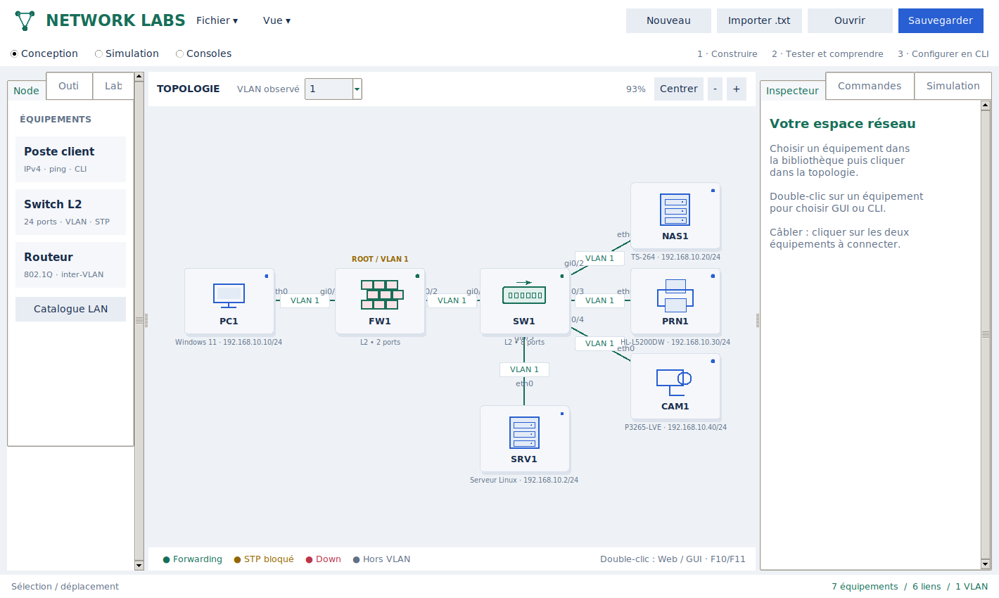
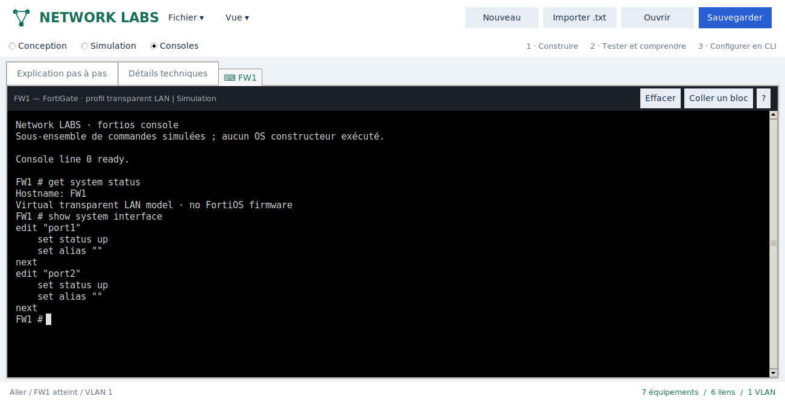

# Comprendre un test réseau

Choisir **Simulation** dans la barre supérieure. Renseigner le poste source,
la destination IPv4 ou DNS, puis ICMP/TCP/UDP. Le port n'est utile que pour
TCP/UDP. Cliquer **Tester et expliquer**.

## Lire le résultat

L'explication dispose d'une liste de décisions et d'un texte lisible pour la
sélection courante. Les boutons précédente/suivante parcourent les décisions.
Le contrôle **Étape** avance le trajet sur le plan et sélectionne le saut
correspondant dans l'explication. La lecture automatique suit aussi les sauts.

1. La demande indique la source, destination, protocole et port demandés.
2. Une résolution DNS réussie est indiquée séparément lorsqu'un nom est utilisé.
3. Pour une IPv4, le poste compare le réseau de destination à son masque et
   détermine s'il doit utiliser une passerelle.
4. Chaque saut retenu indique les nodes, ports, VLAN et représentation taguée
   ou non taguée sur le lien. Le retour est distingué de l'aller.
5. Les décisions firewall reprennent le journal du moteur, avec ID de règle ou
   politique par défaut et suivi de retour. Elles sont regroupées sous Filtrage ;
   ce regroupement n'est pas une chronologie de paquets capturés.
6. Le résultat distingue connectivité, refus réseau et absence de service.

**Détails techniques** conserve le tableau des sauts. Sélectionner une ligne
renvoie à son explication. La CLI, le navigateur et les tests bureau alimentent
le même panneau. Une modification du lab efface l'ancien rapport affiché : il
faut relancer le test après configuration.

## Échecs et pistes

Un refus firewall reprend la règle effectivement rencontrée. Un service fermé
n'est pas confondu avec un chemin réseau absent. Si le moteur ne peut pas
isoler une cause unique parmi VLAN/trunk/STP/passerelle, le panneau donne des
**pistes de vérification**, sans prétendre avoir identifié une panne précise.
Un échec DNS ou une destination invalide ne réutilise pas le trajet précédent.

Le rapport reste pédagogique : pas de capture ARP, handshake TCP, mesures de
latence ou paquets réels. Les temps de l'animation servent uniquement à lire
le chemin calculé.

