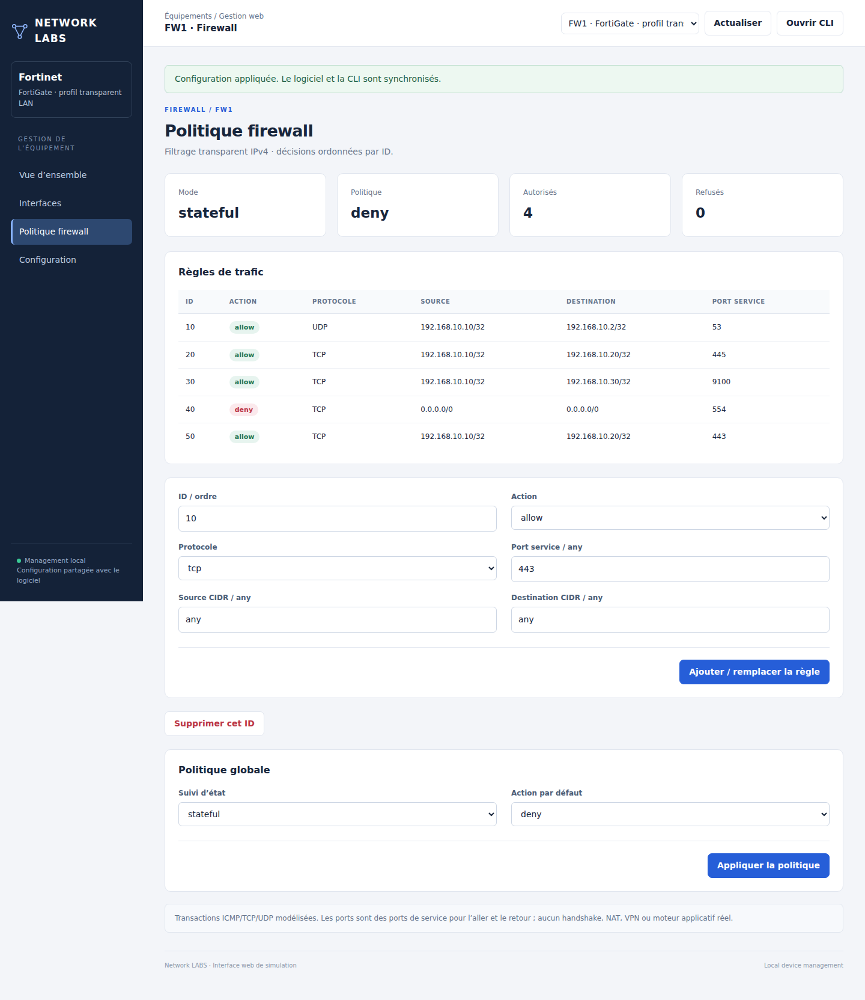
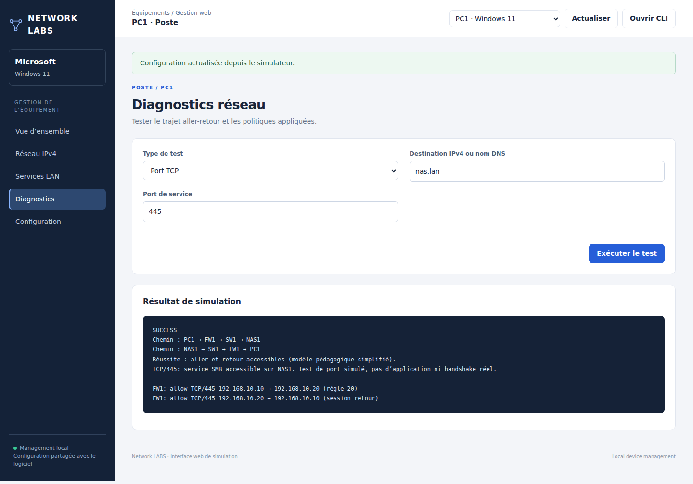
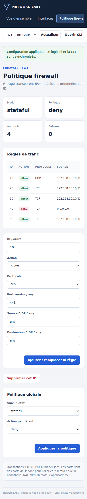

# Interface web locale des équipements

Les équipements réseau se gèrent désormais dans une **vraie page HTML/CSS/JS**
ouverte dans le navigateur du système, reliée au moteur du logiciel.
Cliquer **Interface web · navigateur** dans l'inspecteur. Un double-clic sur un
équipement réseau ouvre sa gestion web ; les postes/portables gardent leur
fenêtre de configuration bureau par défaut. Le clic droit et les boutons
permettent de choisir web, GUI bureau ou CLI.

Le gestionnaire web est une interface du simulateur. Il affiche la marque et le
modèle mais ne charge pas FortiOS, DSM, QTS, UniFi, SwOS ou un firmware constructeur.
Les fonctions non simulées du produit réel ne deviennent pas disponibles en
changeant son nom de modèle.

## Pages fonctionnelles

- Vue d'ensemble : inventaire, interfaces, liens physiques et nom système.
- Endpoints : IPv4 statique/DHCP, passerelle, DNS et interface activée/désactivée.
- Switches : interfaces, VLANs et paramètres globaux STP/VTP/snooping.
- Routeurs : sous-interfaces 802.1Q et pools DHCP.
- Serveurs : activation DNS et enregistrements A.
- Services LAN : activer/désactiver un port TCP/UDP simulé et son nom.
- Firewalls : règles IPv4/protocole/port, politique par défaut, mode et compteurs.
- Diagnostics : ping ou test TCP/UDP, résultat, trajet aller-retour et décisions firewall.
- Configuration : lecture de l'état courant ; bouton pour ouvrir la CLI du logiciel.

Les formulaires utilisent le même parseur que la CLI et la validation atomique.
Une configuration modifiée dans le logiciel produit un conflit de version plutôt
qu'un écrasement silencieux depuis un ancien formulaire web. Actualiser recharge
l'état courant. Un formulaire non appliqué bloque la navigation vers une autre
page jusqu'à application ou actualisation. Les options avancées absentes d'une
page restent disponibles dans les formulaires bureau et la CLI.

## Fonctionnement local

Le logiciel sert la page sur `127.0.0.1` avec un port disponible automatiquement.
Il doit rester ouvert. Aucun serveur à installer, VM, compte externe, dépendance
npm ou accès Internet n'est nécessaire pour l'utilisation normale ; seul un
navigateur local est requis. Le lien est valable pendant l'exécution du logiciel.
Après redémarrage, rouvrir l'interface depuis le logiciel.

Les routes API exigent un jeton aléatoire de session, contrôlent Host/Origin et
ne servent pas de fichiers arbitraires. Le jeton est transporté dans le fragment
du lien puis dans un en-tête, sans journalisation HTTP. Toutes les lectures et
modifications du lab sont exécutées sur le thread du logiciel via une file ; les
threads HTTP ne manipulent pas Tkinter. La fermeture du logiciel arrête le serveur.
Le canal de gestion local est distinct des services/ports virtuels du lab : ouvrir
cette page ne prouve pas l'accessibilité réseau de l'équipement simulé.

## Vérification développeur facultative

Les utilisateurs n'ont pas besoin de ces dépendances. Pour rejouer les tests
navigateur : installer Playwright dans l'environnement Node, puis son Chromium,
et lancer sous un affichage X (ou Xvfb) :

```bash
npm install --no-save playwright
npx playwright install chromium
xvfb-run -a python3 tools/check_browser.py
```

`CHROME_EXECUTABLE` peut désigner un Chromium/Chrome Headless Shell existant.
`QA_OUTPUT` choisit le dossier des captures. Le test crée son propre lab en
mémoire et vérifie les modifications dans le moteur Python : VLAN, rollback,
service NAS, record DNS et règle firewall. Il contrôle également les pages à
1440 px et l'absence de débordement horizontal global à 390 px.

Les tests stdlib API/HTTP/GUI restent disponibles avec :

```bash
xvfb-run -a python3 -m unittest discover -s tests -v
```






