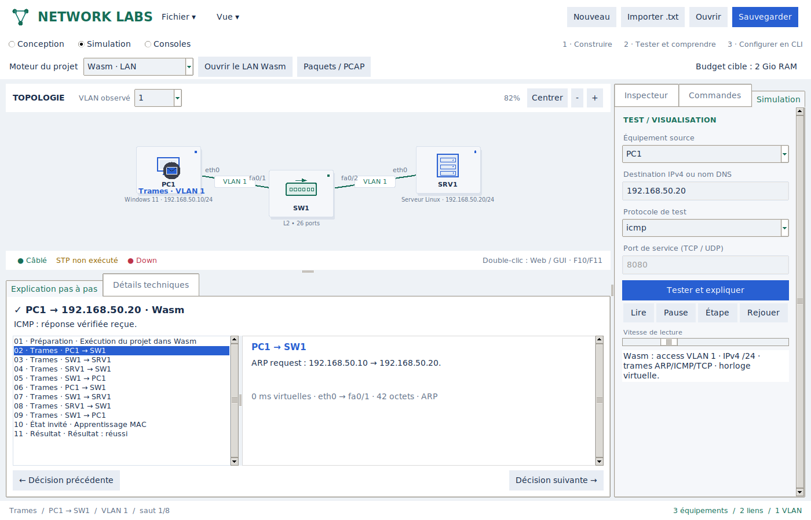
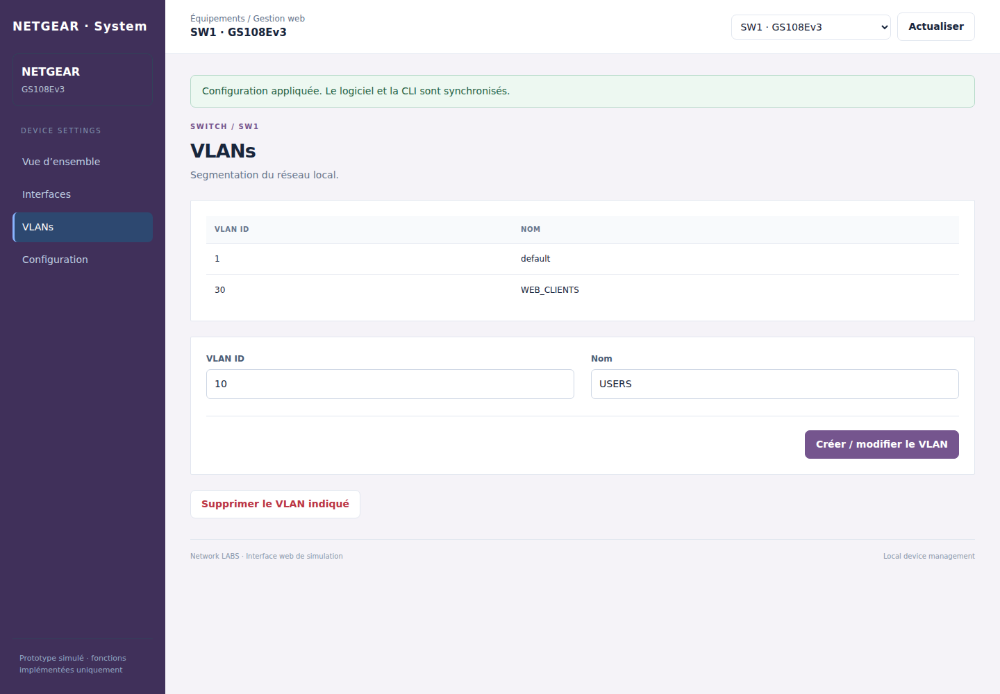

# L’ancien simulateur pédagogique (archive)

> Archive. Ces sections du README décrivaient l’ancien simulateur (« Switching Studio » et son moteur pédagogique,
> le choix de moteur Wasm, les espaces Conception / Simulation / Consoles, les neuf labs intégrés), retiré en
> novembre 2026 : `python3 -m network_labs` ouvre désormais l’atelier des micro-VM. Les commandes et menus cités ici
> n’existent plus dans l’application ; le moteur et ses labs d’exemple restent dans `network_labs/demo_labs.py` et la
> ligne de commande `network_labs.micro_appliances`.

## Essai facultatif : micro-appliances Wasm

Le choix **Moteur du projet → Wasm · LAN** exécute les endpoints et switches de
la topologie courante dans des instances Wasm indépendantes : pile smoltcp,
apprentissage MAC, octets ARP/ICMP et handshake/données TCP echo. Les adresses,
câbles et shutdown configurés en GUI/CLI sont utilisés. **Paquets / PCAP** ouvre
la capture du test. Le moteur pédagogique reste disponible pour les fonctions
non portées ; aucun repli automatique ne masque une limitation du backend Wasm.

Après installation du runtime facultatif, ouvrir directement le projet LAN éditable :

```bash
.venv-micro/bin/python -m network_labs --wasm-lan
```

Périmètre actuel : LAN access VLAN 1 sans boucle active, IPv4 statique /24,
ICMP et TCP echo/8080. Les instances sont recréées à chaque test ; aucun noyau OS
invité ni firmware constructeur. Budget cible du programme : **2 Gio RAM**,
sans garantie de consommation maximale. [Intégration au projet](../WASM_PROJECT.md)
et [installation, sources et mesures](../MICRO_APPLIANCES.md).



## Un espace pour chaque tâche

Pour comprendre le rôle de Python, Rust, Wasm et des commandes natives :
[architecture et limites expliquées](../ARCHITECTURE_FR.md).

Première page de marque spécialisée : **FortiGate → Firewall Policy / Addresses**,
avec formulaires natifs partiels, aperçu CLI, objets nommés et ordre `move before/after`
effectif. Lancer `.venv-micro/bin/python -m network_labs --fortigate-lab` ou
**Fichier → Lab FortiGate · Firewall Policy**. Les autres familles ne sont pas
encore des répliques fidèles de chaque firmware. [Détails](../FIREWALLS.md).

**Conception** affiche le plan et les catégories Nodes/Outils/Labs.
**Simulation** réunit les tests ICMP/TCP/UDP, l'animation et une explication
sélectionnable de chaque décision : demande, DNS, sauts aller/retour, filtrage
et résultat. **Consoles** donne tout l'espace aux terminaux.

Les présentations web dépendent maintenant de la famille : bureau NAS, écran
caméra, état imprimante/téléphone, paramètres Windows/Linux, dashboards et
navigations FortiGate/Palo Alto/pfSense, ainsi que présentations de switches.
Ce sont des interfaces **inspirées**, pas des copies complètes des firmwares.

Les consoles interactives séparent la grammaire interne du simulateur des
sous-ensembles IOS, Windows, Linux, FortiOS, PAN-OS et RouterOS. Une CLI non
implémentée est annoncée comme telle. Voir la [matrice de fidélité, exemples et
limites](../FIDELITY.md) et le [guide de simulation](../SIMULATION.md).

## Choisir web, GUI bureau ou CLI

- Double-clic sur un équipement réseau : **page web locale réelle**.
- Double-clic sur un poste/portable : configuration bureau.
- Inspecteur : **Interface web · navigateur**, **Configuration bureau / CLI**,
  ou console CLI dans le dock.
- Clic droit : mêmes choix ; double-clic sur un port : formulaire Interfaces.
- Les formulaires, pages web et consoles partagent la même configuration.
  Validation atomique des groupes de commandes et détection des formulaires obsolètes.
- La page web propose inventaire, interfaces, VLANs, DNS, services, firewall,
  diagnostics et configuration. Les options avancées restent dans l’éditeur technique ; la CLI dépend du dialecte implémenté.
- Thème bureau clair, panneaux défilants et tailles adaptées à l'écran. F10
  agrandit la topologie, F11 la console du dock. Le prompt reste visible.

[Guide web](../WEB.md) · [Formulaires bureau](../GUI.md).



## Construire et sauvegarder un lab

Choisir un équipement dans la bibliothèque ou le catalogue, puis cliquer dans
la topologie. Déplacer les nodes, choisir « Câbler » puis les deux extrémités et
ports. Le catalogue filtre rôle, marque et modèle. Chaque profil annonce ses
fonctions réelles dans le simulateur ; les références non implémentées ne sont
pas créables.

Les ports sont indépendants : occupation, état administratif, VLANs/trunks,
protections et configuration. Sauvegarder/ouvrir le projet au format JSON.
**Fichier → Importer un lab texte** construit équipements, câbles et
configurations après validation/aperçu. Une erreur indique la ligne et conserve
le lab actuel. Import CLI par équipement et export texte sont également disponibles.

Exemples : [inter-VLAN](../../examples/inter_vlan.lab.txt),
[Windows/Linux](../../examples/windows_linux.lab.txt),
[LAN entreprise](../../examples/enterprise_lan.lab.txt),
[firewall](../../examples/firewall_lan.lab.txt),
[services TCP/UDP](../../examples/service_firewall.lab.txt).

## Moteurs et labs

| Domaine | Fonctions simulées |
| --- | --- |
| Switching | VLAN/access/trunk/native/allowed, ports et ranges, DTP, STP convergé, EtherChannel LACP/PAgP/statique |
| Distribution VLAN | VTP v2 server/client/transparent/off ; MST mono-région et mapping par instance |
| Protections LAN | Port-security/sticky/violation, BPDU Guard, PortFast, DHCP snooping, DAI/IP Source Guard |
| Accès / multicast | Autorisation 802.1X avec backend RADIUS local ; IGMP snooping basé sur les abonnements |
| IPv4 | Adresses/passerelles, router-on-a-stick 802.1Q et réseaux connectés, DHCP serveur/client et exclusions |
| DNS | Serveur local A, édition GUI/web, nslookup et ping par nom ; contrôle d'accès UDP/53 |
| Services | Disponibilité de ports TCP/UDP, sondes et chemins aller-retour ; listes persistantes par endpoint |
| Firewall | Transparent deux ports, règles IPv4/protocole/port, ordre par ID ou séquence native, stateful/stateless et compteurs |

Neuf labs intégrés : inter-VLAN, boucle STP, EtherChannel, DHCP/sécurité, VTP,
MST, LAN entreprise, firewall LAN et services TCP/UDP.

Dans le lab 09 :

```text
probe tcp nas.lan 445
probe tcp printer.lan 9100
probe tcp camera.lan 554
```

NAS/imprimante sont autorisés ; caméra refusée par la règle 40. Ping peut échouer
alors qu'un service TCP passe : les politiques sont distinctes. Le journal de
simulation indique protocole/port, sauts et diagnostics.

[Switching](../SWITCHING.md) · [LAN](../LAN.md) ·
[Services](../SERVICES.md) · [Firewalls](../FIREWALLS.md).

## Matériel et profils

Postes Windows 10/11/Server et Linux Ubuntu/Debian/Rocky, serveurs, imprimantes,
NAS, caméras, téléphones IP, IoT et portables Ethernet. Profils HP, Synology,
Axis, Yealink, QNAP, Brother, Dell/HPE/Lenovo ; modèles de ports Cisco 2960/9200L,
TP-Link TL-SG108E, NETGEAR GS108Ev3, Aruba Instant On 1930, UniFi Lite 8 PoE,
MikroTik CRS326 et D-Link DGS-1210-28. Identités firewall Fortinet, Palo Alto,
Cisco ASA, pfSense, OPNsense, Sophos, Check Point, SonicWall et Juniper.

Les marques/modèles ne chargent pas leur firmware ou leur GUI natif : moteur
pédagogique partagé, gestionnaire web du simulateur et capacité de ports indiquée.
Le catalogue n'est pas exhaustif. [Détails et sources des profils](../MODELS.md).

## Limites importantes du modèle

Dans le moteur pédagogique principal : pas de vrais paquets, stack TCP/UDP, handshakes, retransmissions, délai/débit
mesuré ou OS constructeur. Les services sont des tests de disponibilité, sans
exécution SMB/HTTP, fichiers, impression, vidéo ou voix. Le port firewall est le
port de service pour les deux jambes ; état limité à la transaction courante,
sans ports clients éphémères. DHCP/multicast et protocoles L2 ne sont pas filtrés
par ces règles de transactions.

DNS sans récursion/cache/TTL ; protocoles L2 convergés sans timers ; MST limité
à une région cohérente, frontières mixtes bloquées et signalées. Pas encore de
Wi-Fi, PoE, voice VLAN/passthrough téléphone, SVI/L3, ACL/NAT, VPN, routage dynamique,
IPS/antivirus, NGFW/WAF/proxy ou reproduction exhaustive des CLI et matériels.
Les commandes non implémentées sont rejetées.
